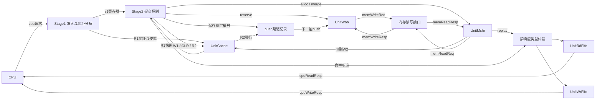
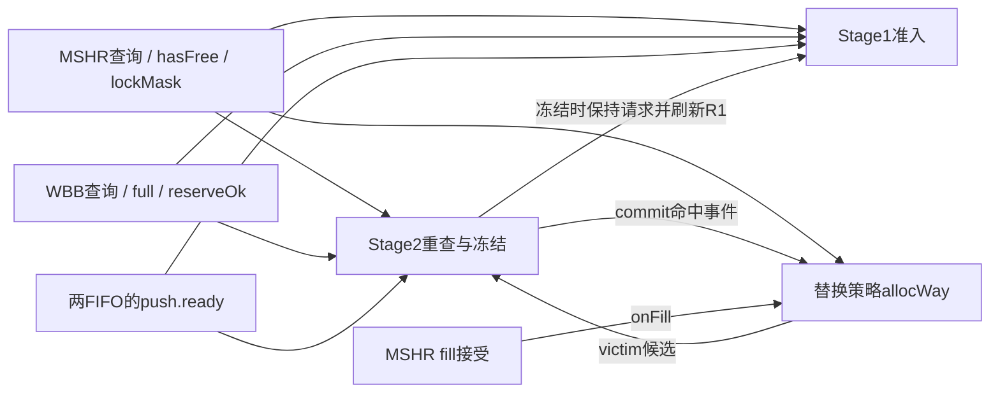
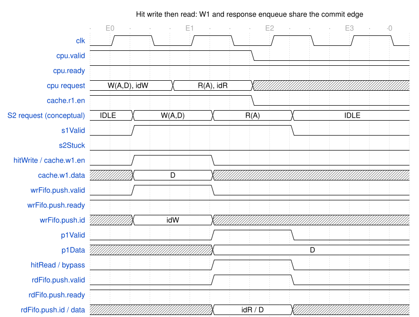
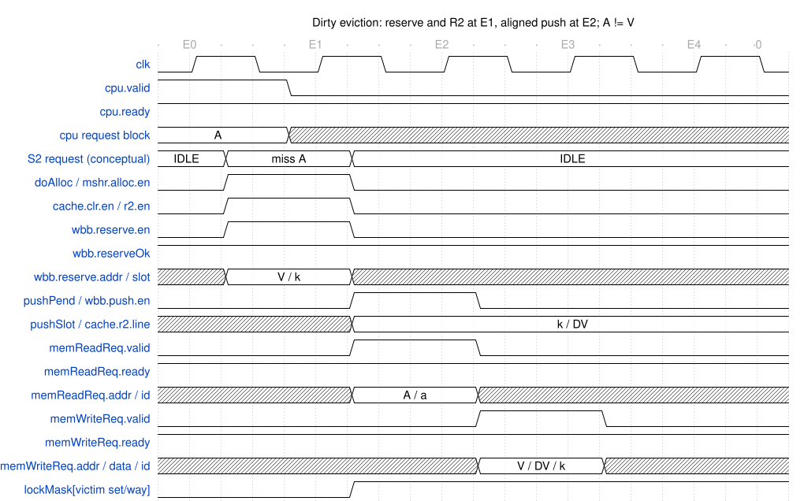
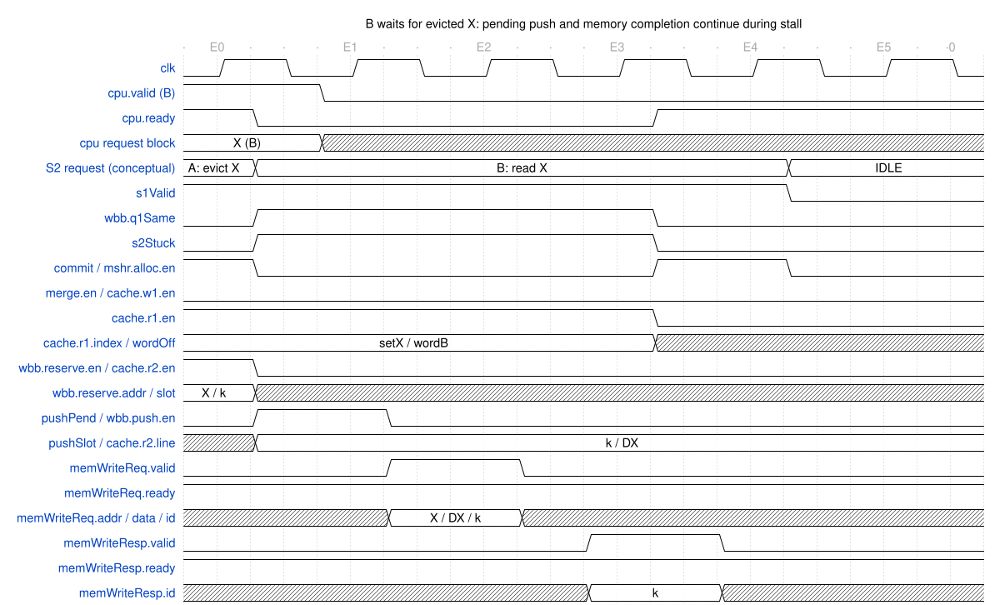
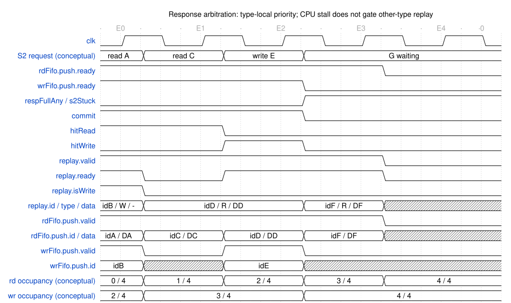

# DCache 顶层集成与连接说明

版本：v1；核对日期：2026-11-20。

本文说明带MSHR的DCache如何连接CacheMem、MSHR、WBB、替换策略和两个CPU响应队列，重点落实到字段来源、接受事件、提交条件和采样沿。它与 [Cache架构设计文档v2](Cache架构设计文档v2.md)、[MSHR IP架构文档](MSHR_IP架构设计文档.md)、[WBB IP架构文档](WBB_IP架构设计文档.md)配套使用。

**当前明确需要对齐的一项是顶层复位生成配置：目标为用户确认的异步低有效，但`DCacheVerilog`仍使用默认ClockDomain配置，尚未显式设置LOW。** 独立IP的低有效生成入口不会自动改变DCache内实例的时钟域。本文记录该差异，不修改DUT，也不把静态接线核对当作集成验证通过。

## 目录

0. 文档口径与源码基线
1. 模块组成与总体连接
2. 时钟复位、参数和编号
3. 端口与字段连接表
4. CPU接收、Stage2提交与冻结
5. CacheMem时相和命中读写旁路
6. victim选择与淘汰原子组
7. WBB同址顺序和生命周期解耦
8. 填充、锁和替换策略联动
9. 响应队列、仲裁和反压
10. 关键集成时序图
11. 集成不变量与验证责任
12. 当前差异、风险与待确认项
13. 生成、验证入口和阅读索引

## 0. 文档口径与源码基线

本文件同时使用两种信息，分别标明：

- **架构要求**：来自总架构、两个IP契约及用户明确决定，定义应满足的行为。
- **当前连接**：来自本次工作区的实际Scala实例化、赋值及已选库接口，说明现在如何实现连接。

两者不一致时，在第12节登记，不能把实现现状反过来写成已确认规格。本次只做源码/接口静态核对和示意图检查，没有重新生成或仿真整个DCache；图中轨迹也不是仿真波形。

| 核对对象 | 负责内容 | 源码入口 |
| --- | --- | --- |
| DCache | 子模块连接、流水、准入/冻结、响应仲裁、push延迟 | [DCache.scala](../Design/DCacheMSHR/src/main/scala/furina/dcache/DCache.scala) |
| 接口与参数 | CPU/内存/查询/replay字段，统一CacheConfig | [Bundles.scala](../Design/DCacheMSHR/src/main/scala/furina/dcache/Bundles.scala)、[CacheConfig.scala](../Design/DCacheMSHR/src/main/scala/furina/dcache/CacheConfig.scala) |
| 存储体 | R1/R2输出对齐、W1/W2/CLR、inspect、逻辑2R2W bank | [CacheMem.scala](../Design/DCacheMSHR/src/main/scala/furina/dcache/CacheMem.scala)、[Ram2R2W.scala](../Design/DCacheMSHR/src/main/scala/furina/dcache/Ram2R2W.scala) |
| 替换策略 | allocWay、onHit、onFill及同set更新 | [ReplacePolicy.scala](../Design/DCacheMSHR/src/main/scala/furina/dcache/ReplacePolicy.scala) |
| 生成与库版本 | 默认FIFO策略、顶层时钟域、SpinalHDL 1.10.2 | [DCacheVerilog.scala](../Design/DCacheMSHR/src/main/scala/furina/dcache/DCacheVerilog.scala)、[build.sbt](../Design/DCacheMSHR/build.sbt) |

本次`DCache.scala`的SHA-256为`e8cf3d2ce578cfc9b642b6e91d1dc204763ef34b1d3e5cb319af4a1f49c07507`。以下连接名称以Scala层级为准，生成RTL的中间线名及展开形式可能变化，正式bind必须核对实际filelist和当轮生成版本。

## 1. 模块组成与总体连接

### 1.1 实例与职责

| Scala对象 | 显式实例名或形式 | 顶层中的职责 |
| --- | --- | --- |
| cache | UnitCache，CacheMem组件 | R1命中读取、R2 victim整行读取、W1命中写、W2填充、CLR清valid、inspect当前valid/dirty |
| mshr | UnitMshr，Mshr组件 | 未命中分配/合并，独占内存读请求，输出fill、replay和锁 |
| wbb | UnitWbb，WriteBackBuffer组件 | 接收脏victim预留/push，独占内存写请求，按写响应释放 |
| policy | 编译期工厂创建的Area/trait | 输出候选way并响应onHit/onFill；不是另一个Stream模块，也不保证生成独立UnitPolicy层级 |
| rdFifo | UnitRdFifo，StreamFifo | 保存CPU读响应，载荷为rData和CPU ID |
| wrFifo | UnitWrFifo，StreamFifo | 保存CPU写响应，载荷只有CPU ID |
| s1*、pushPend/pushSlot、p1* | DCache内部寄存器 | 分别保存待Stage2请求、上次脏淘汰的push义务、命中写旁路信息 |

### 1.2 数据路径



图中的push延迟记录主要保存控制与槽号；实际整行数据由已经对齐的`cache.r2.line`直接送到WBB，没有在顶层另外复制一份整行寄存器。

### 1.3 资源和控制路径



Stage2冻结会停止新的CPU接收和当前请求的提交，后台MSHR/WBB、fill、replay和FIFO pop继续按各自握手推进。这些后台动作正是释放Entry、WBB槽和响应队列空间的来源。

## 2. 时钟复位、参数和编号

### 2.1 时钟域及复位目标

架构目标是统一单时钟域、上升沿采样、异步低有效复位。顶层与各子模块不应在极性上依赖隐含取反，复位期间CPU和内存响应源保持空闲，运行中取消与迟到响应仍需独立系统契约。

当前`DCache`没有对子模块建立独立ClockingArea，`new CacheMem/Mshr/WriteBackBuffer`及两个FIFO继承顶层生成时的ClockDomain。策略和Ram2R2W为Area，也在继承域内。

当前顶层生成入口只设置输出目录和timescale，未设置`ClockDomainConfig(resetKind=ASYNC, resetActiveLevel=LOW)`。本机项目依赖的SpinalHDL 1.10.2默认ClockDomain为RISING/ASYNC/HIGH，因此**顶层入口尚未落实LOW目标**。独立`MshrVerilog`或WBB生成main的配置只在运行那个main时生效，不能视为集成实例已自动改成低有效。

复位应清除流水有效、push待办、旁路有效、MSHR/WBB控制状态及FIFO占用。CacheMem有效/脏位清零，tag/data由Mem实现，不能把未初始化RAM数值当作有效Cache内容；总架构中“所有tag/data清零”的文字与当前存储实现需要分别处理，见第12节。

### 2.2 同一CacheConfig贯穿所有连接

默认配置为32 set、4 way、64 B行、32位地址/字、4 Entry×4 Slot、4 WBB槽、两条深度4的响应FIFO。顶层把同一`cfg`传给cache、mshr、wbb和policy，FIFO的payload也使用该cfg。

| 信息 | 默认宽度 | 跨模块解释 |
| --- | --- | --- |
| CPU地址 | 32 | 字节地址，字对齐 |
| tag / index / wordOff | 21 / 5 / 4 | tag=`addr[31:11]`，index=`addr[10:6]`，wordOff=`addr[5:2]` |
| 单字 / 整行 | 32 / 512 | W1/CPU/replay读为单字，R2/W2/内存行为整行 |
| CPU ID | 5 | CPU输入原样保存至命中响应或MSHR Slot，最终经FIFO返回CPU |
| Entry位次 / WBB槽号 | 2 / 2 | 各自资源所有者，不能当成CPU ID |
| 内存读/写ID | 4 / 4 | 分别由Entry位次、WBB槽号零扩展；两个命名空间独立 |
| lockMask | 128 | `lockMask[set * NUM_WAYS + way]`，Stage1、Stage2与policy按同一位序切片 |

块地址低6位为0，整行最低32位为word0。R2拼行、WBB整行、内存读返回、MSHR合成行和CacheMem W2必须保持同一字序。改变参数后要重新生成整套顶层，并同步TB/参考模型；独立IP的默认参数包不自动代表DCache顶层的配置。

### 2.3 三个不同的完成时刻

| 事件 | 已完成的交接 | 仍未必完成的事情 |
| --- | --- | --- |
| CPU请求握手 | 请求进入DCache流水 | 尚未执行命中写、MSHR提交或产生CPU响应 |
| 命中响应入FIFO或MSHR replay握手 | 结果进入对应响应队列 | CPU还可能因ready=0未消费，CPU ID仍在途 |
| CPU响应pop握手 | CPU看到该笔结果 | 脏数据仍可能只在Cache中，未回写后端内存 |
| WBB内存写请求握手 | 内存接受一笔写回 | 同址读仍要等写响应，WBB槽未释放 |
| 内存写响应握手 | WBB写完成义务结束、槽可释放 | 不触发MSHR释放；两者生命周期独立 |

CPU ID应直到`cpuReadResp.fire`或`cpuWriteResp.fire`才允许全系统复用。MSHR Entry可以在replay入队后释放并服务新的不同CPU ID，不能因此提前把旧CPU ID也回收。

## 3. 端口与字段连接表

### 3.1 七条外部Stream

| DCache端口 | 方向 | 载荷来源/去向 | ready反向路径 |
| --- | --- | --- | --- |
| cpu | 输入 | addr/wrEn/wData/id进入Stage1，accept时保存到s1* | 顶层准入及Stage2冻结共同形成cpu.ready |
| cpuReadResp | 输出 | `rdFifo.pop`的rData/id | CPU ready直接到rdFifo.pop.ready |
| cpuWriteResp | 输出 | `wrFifo.pop`的id | CPU ready直接到wrFifo.pop.ready |
| memReadReq | 输出 | `mshr.memReadReq`的块地址/Entry读ID | 外部ready直接返回MSHR |
| memWriteReq | 输出 | `wbb.send`的victim块地址/整行/WBB写ID | 外部ready直接返回WBB |
| memReadResp | 输入 | 外部valid、整行、ID逐字段接MSHR | MSHR的ready直接返回顶层 |
| memWriteResp | 输入 | 外部valid、ID逐字段接WBB | WBB的ready直接返回顶层 |

顶层没有在内存读写通道间增加仲裁器、共享请求队列或统一ID重编号，也没有读写总在途额度计数。读写可以各自握手、各自响应；共享额度若成为系统要求，须另定管理责任。

### 3.2 查询、读口和元数据

| 源 | 目的 | 字段及使用时相 |
| --- | --- | --- |
| 当前cpu.payload.addr | mshr.q0 | 组合分解后的cpuTag/cpuIndex，Stage1估计 |
| 当前cpu.payload.addr | wbb.q0Addr | cpuBlockAddr，Stage1同址检查 |
| 当前cpuIndex及MSHR锁 | lock0 / hasWay0 | `lock0[w]=lockMask[cpuIndex*NUM_WAYS+w]` |
| s1Tag/s1Index | mshr.q1 | 已接受请求的Stage2重查 |
| s1BlockAddr | wbb.q1Addr | Stage2同址重查，覆盖reserved至写响应完成前 |
| s1Index及MSHR锁 | lock1、hitVec、policy | 当前锁矩阵，参与命中排除和victim选择 |
| accept或s2Stuck | cache.r1.en | 有新请求时读当前CPU地址；冻结时重读s1Index/s1WordOff |
| cache.r1.tag/valid/data | Stage2命中及读数据 | 上一个R1发起沿对应的同步快照，不是组合元数据 |
| s1Index | cache.inspect.index | 组合查询当前set的valid/dirty，用于victim判定 |
| cache.inspect.valid/dirty | emptyVec、victimDirty | 当前状态；无效路上的残留dirty不算脏victim |
| cache.r1.tag(victimWay) | victimBlockAddr | 使用旧行tag快照与s1Index重构写回地址 |

`canMerge0/1`当前写成`mergeable && slotFree`，未再次显式与hit相与。现有MSHR的mergeable本身包含hit，因此当前连接依赖`hit=0 ⇒ mergeable=0`。替换IP时必须保留该保证，或明确由顶层增加hit门控，不能只按未命中时其他字段无意义来随意输出mergeable。

### 3.3 Stage2提交动作

| 目的端口 | 使能 | 载荷来源 |
| --- | --- | --- |
| cache.w1 | hitWrite | index=s1Index，way=hitWay，wordOff=s1WordOff，data=s1WData |
| cache.clr | doAlloc | index=s1Index，way=victimWay；只清valid |
| cache.r2 | doAlloc且evictDirty | index=s1Index，way=victimWay；发起victim整行读 |
| wbb.reserve | doAlloc且evictDirty | addr=victimBlockAddr，使用旧victim的tag |
| mshr.alloc | doAlloc | 新请求tag/index、victimWay、isWrite=s1WrEn、wData=s1WData、wordOff=s1WordOff、respId=s1Id |
| mshr.alloc附带WBB信息 | 与alloc同沿 | hasWb=evictDirty，wbSlot=wbb.reserveSlot；hasWb=0时不解释该slot |
| mshr.merge | doMerge | entry=mshr.m1.entry，类型/字偏移/写数据/CPU ID来自s1* |
| policy.onHit | commit且hit | set=s1Index，way=hitWay；读写命中都发出事件 |

MSHR的alloc不携带指定Entry位次，使用当沿模块给出的空Entry；merge使用Stage2当前m1.entry，不能使用Stage1较早的m0.entry。alloc/merge在当前顶层提交分支中互斥，所以独立IP的双上游同拍扩展不是当前顶层必需能力。

### 3.4 后台填充与写回交接

| 源 | 目的 | 接受事件和对齐 |
| --- | --- | --- |
| 常量True | mshr.fillReady | 当前顶层始终允许fill，没有CacheMem ready返回 |
| mshr.fill.en且fillReady | cache.w2.en | fill接受与整行写入事件相同 |
| mshr.fill.index/way/tag/dirty/line | cache.w2对应字段 | 逐字段直连，无重编码或额外打一拍 |
| 同一个fill接受事件 | policy.onFill | set/way与W2相同，不因CPU冻结停止 |
| 脏淘汰时wbb.reserveSlot | pushSlot寄存器 | 在预留成功的采样沿保存槽号 |
| 脏淘汰事件 | pushPend寄存器 | 为下一拍建立push义务 |
| pushPend / pushSlot / cache.r2.line | wbb.push.en/slot/line | 上次脏淘汰的控制、槽号和同步R2数据在下一沿一起接受 |

WBB push由DCache中的延迟记录驱动，不由MSHR发起。`hasWb/wbSlot`不构成MSHR对WBB的完成控制，也没有把MSHR释放接到WBB释放。

## 4. CPU接收、Stage2提交与冻结

### 4.1 accept与commit分别表示什么

定义E[n]为采样上升沿。`accept=cpu.valid&&cpu.ready`表示本沿接受一笔新请求；s1*在沿后保存它，供接下来的Stage2组合判断使用。虽然变量名以s1开头，它们保存的是**已接受、等待Stage2完成**的请求。

`commit=s1Valid&&!s2Stuck`表示当前Stage2请求在该沿可以执行自己的动作。正常无阻塞时，E[n]接受的请求在E[n+1]提交；在E[n+1]可以同时接受下一笔请求。冻结期间字段保持，提交延后，不重新计CPU请求接受。

### 4.2 当前Stage1准入公式

```text
lock0[w] = mshr.lockMask[cpuIndex * NUM_WAYS + w]
hasWay0 = !AND(lock0)
canMerge0 = mshr.m0.mergeable && mshr.m0.slotFree
missPath0 = !mshr.m0.hit && mshr.hasFree && !wbb.full
            && !wbb.q0Same && hasWay0
respFullAny = !rdFifo.push.ready || !wrFifo.push.ready

cpu.ready = !s2Stuck && !respFullAny && (canMerge0 || missPath0)
accept = cpu.valid && cpu.ready
```

Cache是否命中尚未可知，所以不在Stage1准入公式中。MSHR或WBB满可能保守地挡住一笔最终本可命中的请求；这属于当前架构策略。canMerge0分支不依赖新Entry、新way或WBB空位，但仍受响应队列和Stage2冻结限制。

`respFullAny`在代码中以两个FIFO的push.ready计算，应按实际接收能力理解，不能把名字直接替代所有FIFO实现下的占用数表达式。

### 4.3 Stage2重查与冻结公式

```text
hitVec[w] = cache.r1.valid[w]
            && cache.r1.tag[w] == s1Tag
            && !lock1[w]
hit = OR(hitVec)
canMerge1 = mshr.m1.mergeable && mshr.m1.slotFree
needEvict = !hit && !mshr.m1.hit
reserveFail = needEvict && evictDirty && !wbb.reserveOk

s2Stuck = s1Valid && (
    respFullAny
    || (!hit && mshr.m1.hit && !canMerge1)
    || (needEvict && (!mshr.hasFree || !hasVictim))
    || (!hit && wbb.q1Same)
    || reserveFail
)
commit = s1Valid && !s2Stuck
```

Stage1可合并并不保证Stage2仍可合并：原Entry可能已经接受响应进入FILL，或最后空Slot已被前序请求使用。Stage2必须采用当前m1结果。WBB同址检查也在Stage2重做，防止下一节所述的预留窗口。

Stage2知道victim是否脏，所以只对脏victim要求reserveOk。若请求此前已经进入流水，Stage2选到干净/无效victim时，可以在WBB全满的情况下继续分配；这不等于Stage1已经允许全满时接收所有新miss。

### 4.4 四条互斥提交分支

```text
hitRead  = commit && hit && !s1WrEn
hitWrite = commit && hit && s1WrEn
doMerge  = commit && !hit && mshr.m1.hit && canMerge1
doAlloc  = commit && needEvict && mshr.hasFree && hasVictim
           && !(evictDirty && !wbb.reserveOk)
```

每个已接受CPU请求只能完成其中一个分支。hitRead/hitWrite产生当前命中响应；doMerge/doAlloc只登记MSHR义务，CPU响应以后由replay产生。不能在miss提交时先给CPU应答、又在replay时重复应答。

### 4.5 冻结门控的准确范围

| 冻结时停止或保持 | 冻结时仍应继续 |
| --- | --- |
| cpu.ready拉低，禁止新的accept | 内存读/写请求与响应的独立握手 |
| s1Tag/index/wordOff/blockAddr/wrEn/wData/id及有效义务保持 | MSHR现有Entry推进、fill与W2、policy.onFill |
| 当前请求的hitRead/hitWrite、doMerge/doAlloc为0 | MSHR replay向可接收的对应FIFO入队 |
| 当前请求的W1、CLR、R2、WBB reserve、命中响应、policy.onHit为0 | 两条CPU响应FIFO pop，释放队列容量 |
| 不能重复执行已经提交的动作 | 上一拍成功预留产生的WBB push必须按时完成 |

R1在冻结期间持续重读被保持的s1Index/s1WordOff，以刷新命中判断数据。冻结指保持请求身份，不意味着组合命中结果、查询结果或后台状态全部不许变化；它们变化后，冻结条件才可能解除。

## 5. CacheMem时相和命中读写旁路

### 5.1 同步读与当前状态分开使用

R1发起沿采样index/wordOff，对应tag/数据同步读出；valid、dirty和wordOff也打拍对齐。hitVec取R1.tag/valid快照，同时叠加当前lock1。

victim选择的valid/dirty来自组合inspect，因而能看到前一拍命中写刚置上的dirty。**victimTag仍来自R1.tag(victimWay)快照**。当前实现不是对tag/valid/dirty全部做组合重查，而是使用同步快照、当前锁、当前valid/dirty以及冻结重读共同保护窗口。

这要求验证相邻写后淘汰、填充改变tag/valid、旧victim再访问等边界。只看见inspect端口并不能证明这些窗口全部正确，也不能用当前dirty为1代替检查R2最终读出的数据确实包含最近写入。

### 5.2 命中写和随后命中读

hitWrite驱动W1，bank在提交采样沿执行Mem.write，dirty也在该沿置1；写响应在同一沿入写FIFO。若下一笔同字读的R1读取与W1写同沿发生，RAM原始读结果可能受存储原语read-during-write语义影响。

顶层在命中写沿把tag/index/way/wordOff/data保存到p1*，后续命中读按下面条件旁路：

```text
bypass = hitRead && p1Valid
         && p1Tag == s1Tag && p1Index == s1Index
         && p1Way == hitWay && p1WordOff == s1WordOff
hitReadData = bypass ? p1Data : cache.r1.data(hitWay)
```

无新写且不冻结时p1Valid清除；冻结时保留必要旁路记录，防止等待几拍后丢失这笔读所需的新值。该旁路属于CPU命中路径，与MSHR的“原始返回行＋前序同字写”历史视图是两条不同的数据通路。

### 5.3 R2与逻辑2R2W bank

R2发起时同时保存way，输出整行用保存的rd2WayPipe选择；不能拿当前已变化的R2输入way去解释上次读结果。每个bank也保存读发起时的recency，用它从两组数据副本中选择读结果。

当前Ram2R2W用四份Mem实现两个逻辑读口和两个逻辑写口：A1/A2接W1，B1/B2接W2，每个set保存哪组更新更晚的标记。它不是“一个物理TDP宏直接提供全部2R2W端口”。更换存储原语、减少副本或改用1R1W时，必须重新评估并发带宽、读写冲突和Stage2冻结，不能沿用当前fillReady=True而不检查接收能力。

## 6. victim选择与淘汰原子组

### 6.1 选择顺序及两个地址

```text
emptyVec[w] = !cache.inspect.valid[w] && !lock1[w]
hasEmpty = OR(emptyVec)
emptyWay = 最低编号的emptyVec候选
policyWay = policy.allocWay(s1Index, lock1)
hasVictim = hasEmpty || !AND(lock1)
victimWay = hasEmpty ? emptyWay : policyWay
victimDirty = inspect.valid[victimWay] && inspect.dirty[victimWay]
evictDirty = hasVictim && victimDirty
```

空且未锁的way优先；否则策略必须按自己的偏好顺序剔除锁定way。全部锁定时不能使用策略的无意义候选。CLR只清valid，旧dirty可以残留，因此无效且dirty=1的way不算脏victim。

新MSHR读的是**请求块**，来自s1Tag/s1Index；WBB写的是**被淘汰块**，来自R1中的victimTag和s1Index。二者在正常新行替换中是不同地址，不能把新请求tag误接给WBB。

### 6.2 原子组的同沿使能

| 本沿操作 | 干净或无效victim | 有效脏victim |
| --- | --- | --- |
| MSHR alloc | doAlloc | doAlloc |
| CLR victim.valid | doAlloc | doAlloc |
| MSHR产生目标way锁 | 随alloc建立 | 随alloc建立 |
| WBB reserve | 0 | doAlloc且evictDirty |
| R2整行读 | 0 | doAlloc且evictDirty |
| 保存pushPend/pushSlot | 不为本次新建义务 | 同预留沿保存 |

脏victim时doAlloc已要求reserveOk，因此实际成功reserve、CLR、MSHR分配和R2采样必须属于同一次提交。没有空Entry、没有可用way、WBB预留失败或响应队列阻塞时，整组不执行，不能先清valid再等槽。

表中的“不新建push义务”不取消前一笔脏淘汰已有的push；干净淘汰可以与上一笔push同拍。

### 6.3 一拍后push及连续淘汰

若E[n]完成脏淘汰：

1. 当沿采样victim的index/way发起R2；WBB预留旧块地址并给出槽号k。
2. 沿后pushSlot保存k，pushPend=1，R2输出与该次victim对齐。
3. E[n+1]以保存的k和沿前R2整行完成push，不重新读取当前reserveSlot。

连续脏淘汰时，E[n+1]可以一边push上一笔、一边为下一笔reserve并发R2。旧push在该沿使用旧槽号和旧R2输出，新槽号/新R2结果在沿后更新，为E[n+2]准备。即使新的Stage2请求冻结，已经形成的push义务也不能被门控掉。

## 7. WBB同址顺序和生命周期解耦

WBB的q0Addr查询当前CPU请求块，q1Addr查询已进入Stage2的请求块，两者都不是固定查询victim地址。WBB把reserved、已装载、已发送未响应都计入同址命中。

内存读出口直接连接MSHR，顶层没有再拿memReadReq.addr查询WBB或在出口增加过滤门。因此“不能过早读同址”依赖于提交时的同址重查、块唯一性和锁，使冲突块不能建立新的可发送Entry；集成检查还应在实际内存读出口验证这条结果，不能只看q1接线存在。

典型窗口是：E[n]的A脏淘汰把旧块X预留进WBB，同时Stage1接收紧随的B，B访问X。B的Stage1查询在沿前可能尚未见到新预留；E[n]沿后MSHR锁和WBB地址均已建立。B到Stage2后必须重查，不能用旧R1快照对X形成假命中或过早发出X的内存读。

只接受WBB内存写请求还不够，X必须等对应写响应完成才能重新取数。在写响应接受沿之前，q1Same仍为1，B继续冻结；沿后WBB释放，后续提交才可推进。内存模型宜在读请求握手时保存快照，以免响应时才读数据掩盖“读请求其实发早了”的错误。

对于不同地址，新MSHR行的读取、fill和replay无需等待旧victim的写响应。MSHR最后replay只释放自己的Entry和锁，WBB写响应只释放自己的槽。顶层的`hasWb/wbSlot`字段没有把两个释放事件连在一起。

## 8. 填充、锁和替换策略联动

### 8.1 当前fill接收路径

```text
fillReady = 1
fillFire = mshr.fill.en && fillReady
cache.w2.en = fillFire
policy.onFill.enable = fillFire
```

MSHR输出的index/way/tag/dirty/line直连W2。接受fill的沿上，CacheMem写入最终整行、tag和valid/dirty，policy收到同一set/way的onFill事件。后台fill不依赖CPU commit，也不因响应FIFO满而停止。

当前顶层并没有制造fillReady=0的场景，因此顶层运行不能关闭MSHR IP关于fill反压、多待fill选择保持的Q-02验证点。未来存储体若可能拒绝W2，必须把实际接收能力接回fillReady，并确保W2和onFill只在接受沿生效。

### 8.2 锁保护填充至最后replay的整个阶段

MSHR在alloc后建立目标set/way锁。Stage2命中比较排除被锁way，victim选择也剔除它；fill完成并置valid后，锁仍保持，直到最后一个Slot的replay被响应队列接收。

这使同址新CPU请求在重放期间走MSHR匹配，并因FILL不可merge而等待；不能因为Cache已经valid就越过尚未完成的Slot顺序。释放后正常命中恢复，但CPU旧响应可能仍在FIFO中，所以CPU ID寿命仍另行管理。

### 8.3 onHit与onFill的同拍关系

| 事件 | 顶层参数/使能 | 不应触发的情况 |
| --- | --- | --- |
| onHit | s1Index、hitWay、commit&&hit | 仅R1读到匹配但冻结、MSHR merge、无效请求 |
| onFill | fill.index、fill.way、fillFire | 仅收到内存响应而尚未接受fill、重复观察同一待fill |

FIFO策略命中不改变年龄，只在fill时更新。LRU/PLRU同时使用命中与填充事件。当前代码先调用onHit，再调用onFill；同set同拍时两者的合成并不自动等于“先完成hit更新，再以新状态完成fill更新”。

当前LRU的两个moveToTail都从旧order计算，同set时后onFill覆盖该set整条order。例如旧顺序[0,1,2,3]、hit way0、fill way1，当前结果为[0,2,3,1]；若要求先hit后fill顺序合成，则应为[2,3,0,1]。Q-06需明确是否接受该近似，或者要求两次更新效果都保留。

PLRU不同：它沿访问路径给各位赋方向常量，重叠路径位由后onFill覆盖，非重叠位保留onHit更新；这个位级结果等价于先hit、后fill。这里需要确认架构是否选用该事件次序，不能笼统称PLRU整次命中更新都丢失。

## 9. 响应队列、仲裁和反压

### 9.1 实际连接公式

```text
replayReadFire  = replay.valid && !replay.isWrite
                  && rdFifo.push.ready && !hitRead
replayWriteFire = replay.valid && replay.isWrite
                  && wrFifo.push.ready && !hitWrite
replay.ready = replay.isWrite
               ? (wrFifo.push.ready && !hitWrite)
               : (rdFifo.push.ready && !hitRead)

rdFifo.push.valid = hitRead || replayReadFire
rdFifo.push.rData = hitRead ? hitReadData : replay.rData
rdFifo.push.id    = hitRead ? s1Id : replay.id
wrFifo.push.valid = hitWrite || replayWriteFire
wrFifo.push.id    = hitWrite ? s1Id : replay.id
```

replay分支的FIFO push.valid已经包含push.ready，因此它与源端replay握手是一对一的接受事件。背压义务仍在MSHR的replay Stream上：源端valid及载荷要保持，不能因顶层暂未向FIFO呈现push.valid而丢弃这笔Slot。

### 9.2 按响应类型仲裁

| 同拍候选 | 读FIFO | 写FIFO | replay处理 |
| --- | --- | --- | --- |
| hit读＋replay读 | 收hit读 | 无此组合的新写响应 | replay.ready=0，旧读保持 |
| hit写＋replay写 | 无此组合的新读响应 | 收hit写 | replay.ready=0，旧写保持 |
| hit读＋replay写 | 收hit读 | 可收replay写 | 两个FIFO各自接受 |
| hit写＋replay读 | 可收replay读 | 收hit写 | 两个FIFO各自接受 |

命中优先只针对同一类型，不是跨读写的全局互斥。两条外部CPU响应也可以同拍各完成一个pop；每条响应按自己的类型和ID配对，不能把跨类型到达顺序作为全局FIFO顺序。

### 9.3 任一队满与后台重放

任一FIFO无push空间会通过respFullAny冻结CPU Stage2并阻止新accept。**replay.ready却只看其自己类型的FIFO**，不直接与respFullAny相与。

因此写FIFO满而读FIFO有空间时，CPU Stage2被冻住，读replay仍可进入读FIFO；写replay则等待。这个区别是解除依赖的重要部分，不能为“统一冻结”而额外门控所有replay。两条pop也始终由对应CPU ready独立控制。

### 9.4 FIFO配置和端到端时延

项目使用SpinalHDL 1.10.2的`StreamFifo(payload, RESP_QUEUE_DEPTH)`。本机实际依赖的默认参数为latency=2、forFMax=false，对应同步读、无空队列直通。默认depth=4的总容量为4，内部同步读输出寄存不额外增加第五个对外容量槽；空间以实际CPU pop为依据释放。

应分别记录CPU accept、Stage2 commit/FIFO push和CPU实际pop三个采样沿。FIFO深度特化、内部输出流水、已有排队和CPU反压都影响最终响应时刻，不能把架构的“两拍/三拍”叙述直接写成外部固定响应延迟。

就当前命中写连接而言，W1数据/dirty更新和写响应入队发生在同一个commit采样沿；CPU看见响应还要经过FIFO。架构§6.5/§12.2的周期命名应与该采样沿口径对齐，不能据那段文字要求本实现再额外延迟一个存储写入沿。

## 10. 关键集成时序图

以下为基于连接关系构造的示例，不是实际运行证据。每拍4个绘图刻度，从刻度0起，E0/E1分别位于刻度1/5，输入提前建立，寄存状态在沿后显示更新。绘图间隔不表示真实组合传播延迟。`x`表示字段无效、不作比较，conceptual表示用于解释的逻辑状态/计数；斜杠并列的信号只表示在该示例中同时显示，不额外定义普遍等价关系。

### 10.1 命中写后紧随同字读



[SVG原图](figures/dcache_integration/hit-pipeline.svg) · [WaveDrom源文件](figures/dcache_integration/hit-pipeline.json)

E0接受写A；E1执行它的hitWrite、W1写入和写响应入队，同时接受读A并发起R1。E1沿后p1保存写值D，E2读提交时使用旁路D并入读FIFO。图假定A已是有效且未锁的Cache行，其他准入资源具备；只标内部入队，不把它画成CPU已经pop。

### 10.2 脏淘汰的原子组与下一拍push



[SVG原图](figures/dcache_integration/dirty-eviction.svg) · [WaveDrom源文件](figures/dcache_integration/dirty-eviction.json)

E0接受请求块A；E1为旧块V完成WBB预留、R2采样、CLR和MSHR分配，V与A不同。E2把保存的slot k与R2的DV送进WBB，同时可以首次发送新块A的读请求。E3可以发送V的写回。图假定无竞争且内存请求ready有效，没有要求新块读取等待不同地址V的写响应。

### 10.3 当前请求冻结，旧push仍需完成



[SVG原图](figures/dcache_integration/stall-background.svg) · [WaveDrom源文件](figures/dcache_integration/stall-background.json)

图从前一笔A提交脏淘汰的E0开始，该沿也接受访问旧块X的B。沿后B因WBB q1Same被冻结；E1仍必须push上一笔X，E2写请求握手并不解除同址等待，E3写响应握手时B沿前仍冻结。沿后q1Same清除，假设其他资源已具备，B在E4提交分配。

冻结区间R1继续读B的s1Index，B自身的W1/alloc/merge/reserve均不能重复执行。A在E0建立的后台义务不属于B的冻结门控范围。

### 10.4 响应类型仲裁和单边队满



[SVG原图](figures/dcache_integration/response-arbitration.svg) · [WaveDrom源文件](figures/dcache_integration/response-arbitration.json)

本例两队深度均为4，初始写队占2、读队占0，整个片段没有CPU pop：

| 沿 | 候选/接受结果 | 沿后写/读占用 |
| --- | --- | --- |
| E0 | hitRead A与replayWrite B分别进入两队 | 3 / 1 |
| E1 | hitRead C占用读入队口，replayRead D被阻塞 | 3 / 2 |
| E2 | hitWrite E与仍保持的replayRead D各自入队 | 4 / 3 |
| E3 | 写队满使CPU Stage2冻结，但replayRead F仍进入读队最后一槽 | 4 / 4 |

D在E1与E2的ID/数据必须保持。写队在E2接受实际写响应后才变满；不能把ready无缘无故变低画成一个可实现的FIFO轨迹。

## 11. 集成不变量与验证责任

### 11.1 建议常开的连接检查

| 编号 | 顶层检查要求 | 对应验证点 |
| --- | --- | --- |
| I01 | 每笔accept最终恰好完成一个hitRead/hitWrite/doMerge/doAlloc提交，不丢失、不重复；冻结不commit | PIP-001、PIP-006、INV-004 |
| I02 | s2Stuck时保持s1请求字段，门控本请求副作用，同时R1刷新、后台解除源继续 | PIP-007、PIP-008、INV-008 |
| I03 | 脏doAlloc同沿产生合法reserve、R2、CLR和MSHR分配；资源失败时整组不发生 | EVI-002、EVI-003、PIP-013 |
| I04 | 每次成功脏预留下一拍恰好push相同保存槽号，数据来自同次R2；支持连续淘汰 | EVI-004、EVI-005、EVI-006 |
| I05 | 同址WBB处于reserved/待发/已发未响应时，Stage2不提交该块miss，不提前产生其内存读 | PIP-012、EVI-009、EVI-010、EVI-011 |
| I06 | hit和victim均排除当前锁；不同Entry不占同set/way；fill后直到最后replay才解除 | LCK-002、LCK-004、LCK-005、LCK-006、LCK-007、LCK-010 |
| I07 | W2与onFill由同一个fillFire触发，目标和数据一致，不能因CPU冻结丢失 | POL-014、DCT-011、EVI-020 |
| I08 | 同set/way的CLR与W2、hitWrite与W2按锁排他；不能依赖非法冲突下碰巧最后赋值覆盖 | MEM-015、EVI-015 |
| I09 | replay握手对应且仅对应一个同类型FIFO push，完整CPU ID/数据保真 | RSP-006、RSP-007、END-003 |
| I10 | 任一队满反压CPU；另一类型有空间时replay及两个pop仍按各自条件推进 | RSP-005、RSP-010、INV-008 |
| I11 | hit读RAW比较tag/index/way/word全部匹配，冻结后仍无旧数据或误旁路 | PIP-002、PIP-004、PIP-005 |
| I12 | onHit仅由commit命中触发，onFill仅由W2接受触发；同set双更新按确认口径检查 | POL-011、POL-013、POL-014、POL-015 |
| I13 | 内存读ID与Entry对应、写ID与WBB槽对应；各自唯一在途且高位合法，跨通道同值可并存 | CFG-006、INV-006 |
| I14 | CPU ID保持至真实CPU pop，不在replay入队时提前释放；两个响应类型分别按ID检查 | CFG-013、RSP-008、RSP-012、END-003 |
| I15 | victim当前dirty、R1旧tag和R2数据对应同一被淘汰版本，不能只检查其中一个字段 | EVI-007、EVI-008、EVI-012、EVI-014、EVI-018 |

这些是拟用于顶层验证的要求与观察位置，本文件没有实现这些断言，也不据静态赋值把对应验证点标为闭合。

### 11.2 IP输入约束在顶层变成输出责任

WBB IP环境约束“成功reserve不得同址重复”；真实DCache必须通过victim选择、锁和同址调度保证这一点。MSHR IP环境约束“alloc块唯一、set/way唯一、merge只在允许阶段且有Slot”；顶层必须用提交沿的查询和资源结果满足它们。

因此不能在顶层仍把内部alloc/merge/reserve错误只归因于“环境不合法”。从CPU/内存外部施加的是系统前提，模块间由DCache产生的非法输入属于集成DUT错误，检查器需要报告实际驱动责任方。

### 11.3 收尾与参考数据的分层

顶层scoreboard应从CPU握手记录请求类型、地址和ID，并按CPU响应握手完成配对；另外跟踪MSHR、WBB和两个FIFO的义务。对无取消、从空态开始的区间：

```text
CPU接受数 - CPU读/写响应完成数
    = 等待Stage2的请求数
      + MSHR中尚未replay的Slot数
      + 读FIFO待CPU消费数 + 写FIFO待CPU消费数
```

上式的FIFO待消费数包括内部输出流水中尚未完成CPU pop的响应，不能因为内部预取就提前扣除。

所有内部队列排空也不代表后端内存等于CPU可见架构内存，因为Cache中仍可能保留dirty行。若要检查最终后端一致性，需要合法驱逐受测脏行并等相应写响应；无flush端口时不能靠“等待足够久”假定自动写回。每次写回应与该次victim版本比较，不拿后来CPU更新后的最终值替代。

## 12. 当前差异、风险与待确认项

| 项目 | 架构目标或要求 | 当前静态事实 | 后续核对范围 |
| --- | --- | --- | --- |
| 顶层复位 | 用户已确认统一异步低有效 | DCacheVerilog未显式LOW，当前库默认ASYNC/HIGH；独立IP main不影响集成域 | 修改生成配置需另行落实，再核对顶层/子模块/TB复位与取消语义；RST-001及Q-04 |
| 生成版本 | 当前Scala、RTL、TB参数应对应同一版本 | 现存rtl/DCache.v头部Git为15359a…，仍有旧lockMask展开结构；不能充当本次Scala连接的运行证据 | 正式集成前重新生成并记录输入/RTL版本，不用旧文件推定已验证 |
| 命中写拍数 | 精确区分接受、提交、入队、CPU完成 | 当前W1生效和写响应push同一commit沿；外部响应另经FIFO | 按实际沿记录PER-006，统一架构§6.5/§12.2的周期措辞 |
| 命中与victim元数据时相 | 地址/版本必须一致，窗口不得误命中或误淘汰 | 命中用R1快照＋当前锁，victim valid/dirty实时，victimTag仍为R1快照 | EVI-007/008/012/014的精确相位case；静态接线不能证明全部窗口 |
| W1/W2冲突兜底 | 架构备用规则描述W2优先、W1冻结重试 | 当前无顶层冲突冻结项；bank仅在冲突时选择W2为较新副本 | 正常路径证明锁排他；变更存储端口方案时补完整接收/重试，不宣称兜底已实现 |
| 同set策略双更新 | onHit/onFill语义都应明确 | LRU后onFill覆盖整条旧状态计算；PLRU位级结果等价于先hit后fill | Q-06、POL-015分别确认LRU近似/合成及PLRU事件次序，不自动判数据功能失败 |
| mergeable有效性 | 替换IP时接收资格不能误判 | canMerge0/1依赖MSHR的hit=0⇒mergeable=0 | 顶层与MSHR契约共同保持该条件，不能混用不同的无效字段口径 |
| fill接收能力 | 只在真正能写W2时接受fill | 当前fillReady=True，无外部CacheMem ready | 当前固定ready场景可单独验证，MSHR反压Q-02仍由IP验证；换存储体需重审 |
| RAM复位与冲突 | 有效数据判定及RAW行为明确 | Mem数据/tag未逐项复位；读写语义依赖所选Mem，顶层有旁路和锁 | 不比较无效RAM内容；Q-05及MEM/PIP相关case |
| 共享额度及进展 | 读写资源不越界，有限流量可排空 | 内存读写直连无共享额度计数；固定优先/命中优先不保证无限压力无饥饿 | Q-07/08及有限集合watchdog/统计 |

上表的“当前静态事实”与“已由仿真复现的功能bug”分开使用。复位生成入口的配置差异已明确；其他涉及动态窗口、策略取舍或库时序的结论需要对应场景证据。若确认DUT错误，应记录触发轨迹、违反的要求及影响，本次不自行修改实现。

## 13. 生成、验证入口和阅读索引

当前项目默认main是`furina.dcache.DCacheVerilog`，生成目录为`Design/DCacheMSHR/rtl`，工厂固定为FifoPolicyFactory。FIFO/LRU/PLRU是编译期选择，改变策略需重新生成并同步TB/模型，不能只更改测试中的一个运行时字段。

WBB和MSHR独立环境分别位于`verif_mshr/sim_wbb`与`sim_mshr`，其生成物在`generated/wbb`与`generated/mshr`。它们验证各自IP，不自动替代DCache顶层接线、响应FIFO和淘汰原子组的验证。历史顶层`mshr_smoke_test`与当前独立MSHR环境同名test属于不同测试对象，应按版本及filelist区分。

顶层生成物的子模块定义应来自同一轮生成清单，不能把独立IP目录里同名的Mshr/WriteBackBuffer RTL直接混入，造成重复定义或复位/参数不一致的替换。

后续顶层验证应使用独立top/filelist，首先核对复位配置、所选policy、CacheConfig、生成RTL和TB字段映射，再接入CPU激励、后端内存、架构数据参考及连接断言。完整顶层验证点维护在 [DCache顶层验证](../验证计划/DCacheWithMshr/DCache顶层验证.md)，本文提供它们的实际观察位置和责任边界，不改变现有执行状态。

主要源码定位如下，行号对应本次核对快照：

| 文件区段 | 阅读内容 |
| --- | --- |
| DCache.scala 37起 | 实例化及七条外部Stream连接 |
| DCache.scala 87起 | Stage1查询、准入和响应队列空间 |
| DCache.scala 108起 | Stage2查询、命中、victim与冻结 |
| DCache.scala 168起 | 四条提交分支、W1、淘汰原子组及MSHR字段 |
| DCache.scala 212起 | policy事件、W2、push延迟 |
| DCache.scala 237起 | RAW旁路及响应仲裁 |
| CacheMem.scala 100起 | R1/R2对齐、bank连接、valid/dirty更新 |
| ReplacePolicy.scala 60起 | 状态更新及同set双事件处理 |
