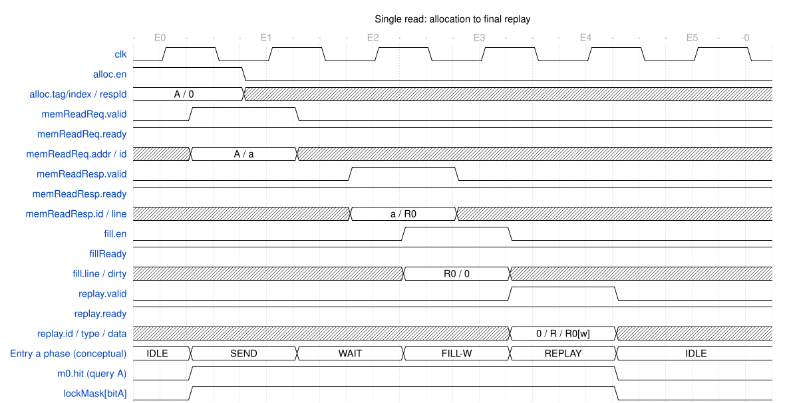
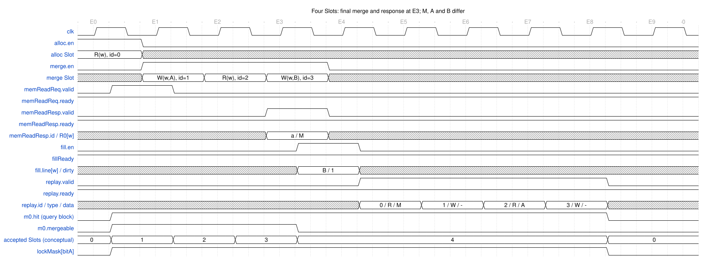
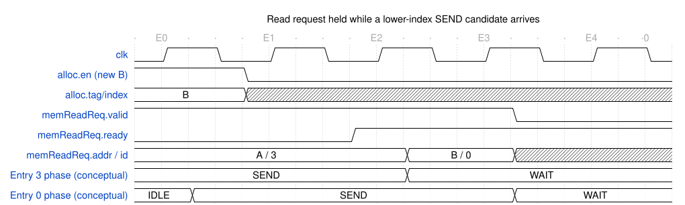
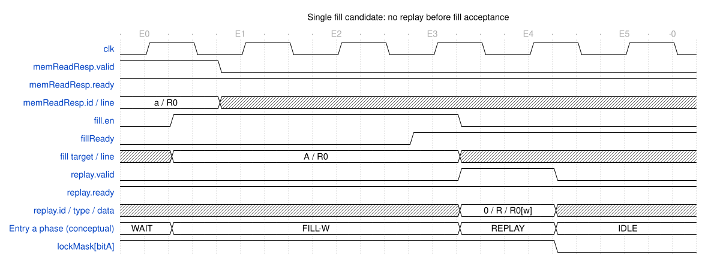
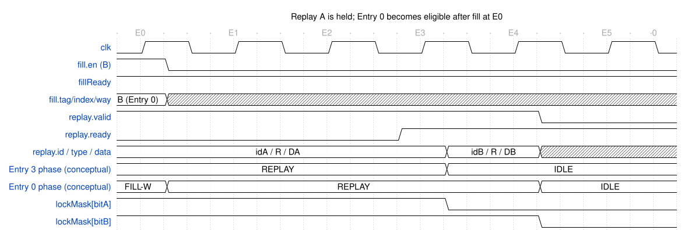
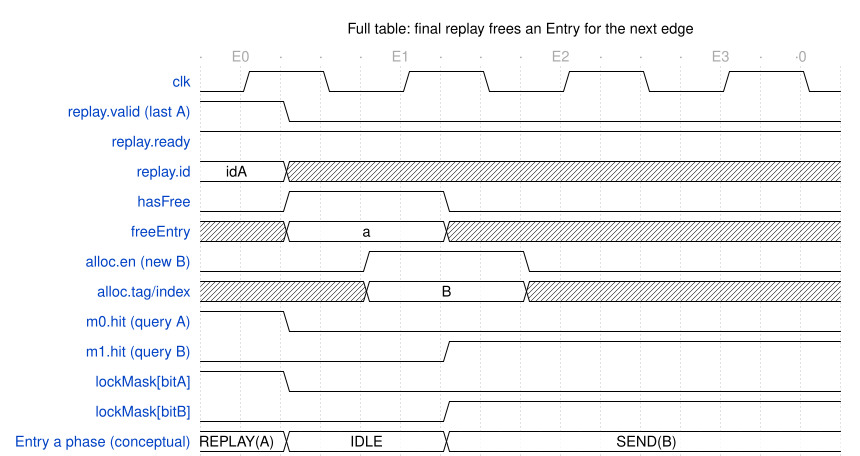
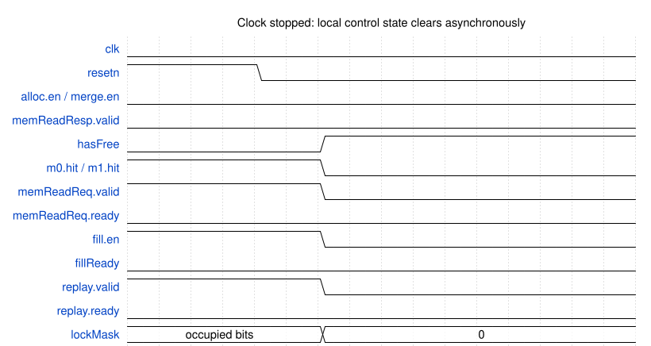

# MSHR IP 架构设计文档（v1）

> 版本：v1；更新日期：2026-11-20；状态：独立接口契约基线，含补充定义与待确认扩展。
> 依据：《带 MSHR 的非阻塞数据 Cache 架构设计文档 v2》、用户确认事项及 MSHR 顶层 IO 定义。
> 本文不以现有 HDL 内部逻辑、C++ 模型输出或某个 test 的通过结果倒推正确行为。
> 用户确认：**采用异步低有效复位，放弃异步高有效方案。**

## 目录

0. 文档说明与契约来源
1. 引言与模块边界
2. 总体架构与事务所有权
3. 参数、地址、数据及 ID
4. 接口定义
5. 时钟、复位与事件记法
6. Entry 与 Slot 生命周期
7. 查询、分配与合并
8. 内存读请求与响应
9. 填充与整行数据合成
10. 重放、读历史视图与顺序
11. Way Lock 与资源释放
12. 同拍裁决与 corner 定义
13. 时序图与边沿示例
14. 守恒、进展与异常边界
15. 验证责任与可观察范围
16. 集成要求与待确认事项

## 0. 文档说明与契约来源

MSHR位于Cache请求提交、内存读通道、整行填充和响应重放之间。本文把这些路径展开成可以独立驱动、独立检查的接口契约：哪些输入构成一次提交、字段在哪个沿有效、同拍发生的事件怎样共同生效，以及资源何时重新可用。

| 标签 | 含义 | 主要内容 |
| --- | --- | --- |
| 【继承】 | Cache架构已经规定 | 一块一个Entry、Slot接收顺序、SEND/MISS_WAIT合并、一次内存读、写合成、读历史视图、Entry间重放轮询、锁的完整生命周期 |
| 【用户确认】 | 用户明确作出的规格决定 | 异步低有效复位 |
| 【接口定义】 | 顶层IO声明提供的信息 | 信号名、方向、字段宽度、Stream与使能接口的区别 |
| 【补充定义】 | 将原文未精确到边沿的要求写成可检查基线 | 同一沿前状态裁决、默认无同沿新资源旁路、无效字段检查条件、lockMask打包位序、重放握手超越界 |
| 【当前配置】 | 当前独立验证采用的范围，不代表所有可选协议都已定案 | 每拍最多一次alloc或merge；读响应至少晚于其请求一个采样沿 |
| 【待确认】 | 现有架构和IO不足以唯一决定 | 独立IP双上游提交、零拍读响应、多待fill候选的保持/选择策略、热复位取消与旧响应隔离 |

主要出处为 [Cache架构文档v2](Cache架构设计文档v2.md) §3、§4、§7、§10.4、§11、§12.3/12.4、§13；[设计问题与取舍记录](设计问题与取舍记录.md) §3、§7.2用于解释这些决定。端口由 [Mshr的IO声明](../Design/DCacheMSHR/src/main/scala/furina/dcache/Mshr.scala)及 [Bundles定义](../Design/DCacheMSHR/src/main/scala/furina/dcache/Bundles.scala)识别，不把声明之后的实现当作规格。

Cache架构§13原有“同步复位”描述与用户最新决定不同，MSHR按本文的异步低有效要求执行。字段宽度和默认参数的整理不等于已经验证全部参数组合。文中抽象状态、计数和保持职责均不要求使用同名寄存器。

## 1. 引言与模块边界

### 1.1 设计目的

一次Cache未命中需要等待内存返回整行。在等待期间，MSHR保存这条行上的请求，使其他行能够继续处理；后续访问若属于同一块且仍允许合并，就追加到已有Entry，避免重复读内存。数据返回后，MSHR合成最终填充行，再按每笔请求应当看到的数据版本依次返回结果。

### 1.2 本模块负责的内容

MSHR负责Entry分配、同块匹配、Slot追加、内存读发送与在途跟踪、响应归属、整行填充、请求重放以及lockMask输出。多个Entry可以独立推进，内存响应和不同Entry的完成顺序不要求与分配顺序相同。

它不接收原始CPU请求Stream，不决定Cache是否命中，不选择victim，不直接产生cpuReady，不驱动WBB预留/push，不处理内存写响应，也不实现响应FIFO。alloc中的way由上游选择；fill只是向CacheMem及其控制逻辑提交一次整行更新。

### 1.3 非目标

当前接口不定义字节写掩码、部分行返回、总线错误码、重试、单Entry取消、投机回滚、刷新、一致性探测、AXI突发封装或硬件超时。不能把非法ID当作正常重试，也不能要求没有相应控制端口的MSHR自行处理这些功能。

## 2. 总体架构与事务所有权

```text
                    上游Stage2提交控制
               alloc / merge       q0 / q1
                     │                │
                     ▼                ▼
             +----------------------------------+
             | Entry资源、块匹配、Slot接收顺序    |──> hasFree/freeEntry、m0/m1
             |              │                   |──> lockMask
             | 待发选择与请求保持 ────────────────|──> memReadReq
             | 原始返回行保存 <──────────────────|<── memReadResp
             |              │                   |
             | 全部写Slot合成 ───────────────────|──> fill / fillReady
             | 各Slot的历史视图与Entry间轮询 ─────|──> replay
             +----------------------------------+
                           CacheMem / 下游响应通路
```

一个Entry对应一个块的一次未完成处理过程；一个Slot对应一笔已提交的读或写。`alloc`同时创建Entry和首Slot，`merge`只向已有Entry追加Slot。即使所有Slot都是写，仍要获取原始行，以保存没有被写到的字。

合法alloc/merge被采样后，MSHR取得返回这些Slot结果的义务。内存请求握手只表示读请求已被接受；读响应握手只表示原始行已交给MSHR；fill接受只表示最终行已交给Cache更新路径。**只有该Entry最后一个Slot的replay握手，才结束Entry和锁的占用。**

replay握手表示结果已交给下游响应通路。若后面还有响应FIFO，这不等于CPU已经消费结果，CPU ID何时可以全系统复用仍由集成端管理。

## 3. 参数、地址、数据及 ID

### 3.1 参数与派生宽度

记`N=MSHR_ENTRIES`、`P=MSHR_MAX_PENDING`、`W=WORDS_PER_BLOCK`。

| 参数或字段宽度 | 默认值 | 含义或计算关系 |
| --- | --- | --- |
| ADDR_WIDTH | 32 | 字节地址宽度 |
| DATA_WIDTH | 32 | 单字数据宽度，整字读写 |
| BLOCK_SIZE | 64 B | 一行字节数 |
| LINE_WIDTH | 512 | `8 * BLOCK_SIZE = W * DATA_WIDTH` |
| NUM_SETS / NUM_WAYS | 32 / 4 | 组数/路数 |
| N / P | 4 / 4 | Entry数/每Entry的Slot数 |
| BYTE_WIDTH / W | 4 B / 16 | `DATA_WIDTH / 8`、`BLOCK_SIZE / BYTE_WIDTH` |
| INDEX_WIDTH / WAY_WIDTH | 5 / 2 | set/way索引宽度 |
| OFFSET_WIDTH / WORD_OFF_WIDTH | 6 / 4 | 块内字节偏移/字偏移宽度 |
| TAG_WIDTH | 21 | `ADDR_WIDTH - INDEX_WIDTH - OFFSET_WIDTH` |
| ENTRY_WIDTH / SLOT_WIDTH | 2 / 2 | Entry/Slot位次宽度 |
| CPU_ID_WIDTH | 5 | alloc/merge的respId与replay的id宽度，对应Cache参数ID_WIDTH |
| BUS_ID_WIDTH | 4 | 内存读请求/响应ID宽度 |
| WBB_SLOT_WIDTH | 2 | alloc.wbSlot宽度，默认WBB有4槽 |
| LOCK_WIDTH | 128 | `NUM_SETS * NUM_WAYS` |

【继承】组数、块大小、字节字宽和Entry数满足Cache架构§3.3的2幂约束，块大小是字节字宽的整数倍。字宽必须为整字节，tagWidth必须为正，所有有效索引必须能被对应字段完整表达。

【补充定义】单Entry或单Slot配置的端口至少保留1位，唯一合法位次为0。上述索引宽度按`max(1, ceil(log2(容量)))`理解；计数若要表达0到P，应能表示P本身，不能用只能表示0到P−1的位次宽度代替。

架构原文没有完整列出P、way及所有数据宽度的支持集合。本文不承诺任意数学上可编码的配置都能直接生成和仿真；当前生成配置限制、C++数据类型限制和非法参数拒绝分别在配置验证中登记，不从默认4×4结果外推。

### 3.2 地址与字序

alloc提供tag、index和wordOff，merge只提供目标Entry和wordOff。块地址按下式重构：

```text
blockAddr = (tag << (INDEX_WIDTH + OFFSET_WIDTH))
          | (index << OFFSET_WIDTH)
wordByteAddr = blockAddr + wordOff * BYTE_WIDTH
```

默认布局为tag=`addr[31:11]`、index=`addr[10:6]`、wordOff=`addr[5:2]`，低2位字节偏移为0。内存读地址低6位为0。查询键只有tag和index，同行不同wordOff必须匹配同一Entry。

word0对应行总线最低`DATA_WIDTH`位；默认是`line[31:0]`。最低字节地址对应`line[7:0]`。fill与内存返回行使用相同布局，读replay选择相应完整字，写Slot只替换对应完整字，不产生字节掩码。

### 3.3 三类编号不能混用

| 编号 | 来源 | 用途与有效期 |
| --- | --- | --- |
| Entry位次 | 分配沿观察到的freeEntry | 标识当前Entry生命周期；到最后replay握手之后才可重新分配 |
| 内存读ID | Entry位次零扩展 | 关联一次读请求和一次读响应；完整ID的高位必须为0，不能截掉非法高位后视为合法 |
| CPU ID | 上游alloc/merge.respId | 随Slot保存，在replay中原样返回；读写类型也必须对应原Slot |

读响应完成后，虽然该读ID已不再等待内存，Entry仍可能等待fill或replay，不能立即重新分配同一Entry。内存写ID属于WBB的独立命名空间，数值相同不代表同一事务。

独立MSHR最多容纳N×P个Slot；若要同时填满所有Slot并使用唯一CPU ID，其ID空间需容纳这些请求。Cache架构的`N*P + 1 + 2*RESP_QUEUE_DEPTH`是包含流水和响应FIFO的**全系统**预算，不是MSHR内部单独增加了这些槽位。

【当前配置】独立IP测试把replay接收端视为最终消费端，完成沿之后的提交才复用相应CPU ID，不在同一沿完成旧ID并提交同ID新请求。真实DCache中则必须保持到CPU响应真正被消费，不能在写入响应FIFO时提前复用。

## 4. 接口定义

方向以MSHR为参照。下表采用生成Verilog中的下划线名称；`alloc_*`与架构中的`alloc.*`对应。两个查询口分别用`i=0/1`表示。

| 接口组 | 信号 | 方向 | 有效条件和含义 |
| --- | --- | --- | --- |
| 时钟复位 | clk / resetn | 输入 | 上升沿采样；resetn异步低有效，TB逻辑名rst_n直接连接 |
| 分配 | alloc_en | 输入 | 合法前提下本沿提交一个新Entry及首Slot；没有alloc_ready |
| 分配 | alloc_tag / alloc_index / alloc_way | 输入 | alloc_en=1有效，新块标识及上游选定的Cache路 |
| 分配 | alloc_isWrite / alloc_wordOff / alloc_respId | 输入 | 首Slot的读写类型、字位置和CPU ID |
| 分配 | alloc_wData | 输入 | alloc_en且isWrite时有效的整字写数据 |
| 分配 | alloc_hasWb / alloc_wbSlot | 输入 | victim是否关联WBB预留及其槽号；hasWb=0时wbSlot不作功能值要求 |
| 合并 | merge_en / merge_entry | 输入 | 本沿向沿前合法的已有Entry追加一个Slot；没有merge_ready |
| 合并 | merge_isWrite / merge_wordOff / merge_respId | 输入 | 追加Slot的类型、字位置和CPU ID |
| 合并 | merge_wData | 输入 | merge_en且isWrite时有效的整字写数据 |
| 查询 | q0_tag/index、q1_tag/index | 输入 | 两个独立且常开的块查询，无enable |
| 查询结果 | m0_hit、m1_hit | 输出 | 查询块是否属于任一占用Entry，包括FILL及重放阶段 |
| 查询结果 | mi_entry | 输出 | hit=1时有效的匹配Entry |
| 查询结果 | mi_mergeable | 输出 | 命中Entry的阶段是否允许追加：SEND或MISS_WAIT；不是单独的接收许可 |
| 查询结果 | mi_slotFree / mi_freeSlot | 输出 | hit且mergeable时按§7.1定义有效容量及下一追加位置；不能单凭slotFree提交 |
| Entry资源 | hasFree / freeEntry | 输出 | 是否存在沿前空Entry；hasFree=1时freeEntry指向实际可分配位置 |
| 内存读请求 | memReadReq_valid / memReadReq_ready | 输出/输入 | valid&&ready为读请求接受事件 |
| 内存读请求 | memReadReq_payload_addr / id | 输出 | valid时的块对齐地址与完整读ID |
| 内存读响应 | memReadResp_valid / memReadResp_ready | 输入/输出 | valid&&ready为原始返回行接受事件 |
| 内存读响应 | memReadResp_payload_rData / id | 输入 | valid时的完整行与对应读ID |
| 填充 | fill_en / fillReady | 输出/输入 | en&&fillReady为一次整行填充接受事件；这是自定义使能接口 |
| 填充 | fill_index / fill_way / fill_tag | 输出 | fill_en时有效的原分配目标，无Entry ID字段 |
| 填充 | fill_dirty / fill_line | 输出 | fill_en时有效的脏标志和最终合成整行 |
| 重放 | replay_valid / replay_ready | 输出/输入 | valid&&ready为一个Slot结果接受事件 |
| 重放 | replay_payload_isWrite / id | 输出 | 原Slot类型和CPU ID；没有Entry/Slot位次字段 |
| 重放 | replay_payload_rData | 输出 | replay_valid且isWrite=0时有功能意义的读字 |
| 路锁 | lockMask | 输出 | 当前全部占用Entry形成的set/way锁矩阵，打包为LOCK_WIDTH位 |

只有memReadReq、memReadResp、replay明确为Stream。alloc/merge的en不是等待ready的valid；fill.en也不能未经确认直接套用Stream保持规则。q0/q1是组合查询，不是请求提交。

所有有效控制、有效索引和有功能意义的载荷必须为已知值。无效发送、fill或replay载荷不要求为0；读请求中的wData、hasWb=0时的wbSlot、写replay的rData不作功能值比较。Stream一旦呈现并受阻，整个载荷仍须保持到握手，包括写replay中没有功能值要求的数据位。

## 5. 时钟、复位与事件记法

### 5.1 沿前状态和接受事件

记第n个上升沿为E[n]，Q[n]为该沿之前的逻辑状态。输入在该沿前建立，所有事件先用同一Q[n]判断合法性，再共同形成沿后状态。

```text
A[n] = alloc_en[n]                               分配提交，前提合法时必须接受
G[n] = merge_en[n]                               Slot追加，前提合法时必须接受
S[n] = memReadReq_valid[n] && memReadReq_ready[n]  读请求接受
R[n] = memReadResp_valid[n] && memReadResp_ready[n] 原始行接受
F[n] = fill_en[n] && fillReady[n]                 填充接受
P[n] = replay_valid[n] && replay_ready[n]         Slot重放接受
```

A/G没有DUT返回的accepted信号；“en为1但资源不合法”是上游违约，不是模块可以合法忽略的一次失败尝试。一次合法提交无需额外空拍，连续两拍en为1意味着两次提交，分别必须合法。

【补充定义】默认不做alloc到首次send、读响应到fill或释放到新分配的同沿直通。沿后组合传播完成后查询和锁反映新状态，下一采样沿必须可见；这不规定输出一定来自组合线还是寄存器，也不规定某个具体传播延迟。

### 5.2 异步低有效复位

【用户确认】resetn=0无需等待时钟有效沿即清除本地Entry/Slot占用、待发送与待重放状态。可见空态要求：

```text
hasFree = 1
m0_hit = m1_hit = 0
memReadReq_valid = 0
fill_en = 0
replay_valid = 0
lockMask = 0
```

复位不承诺freeEntry选择某个固定空Entry，不要求无效载荷清零，也不强制memReadResp_ready为0。复位期间上游保持alloc_en=merge_en=0，内存侧保持memReadResp_valid=0，不承认传输。

常规仿真在下降沿释放复位，释放前控制和常开查询必须为已知值。真实实现的recovery/removal、异步断言及同步释放电路单独做时序检查，不能以RTL仿真的小延迟替代。

复位清除本地状态不意味着已经被内存接受的读被取消，也不意味着已经接受的fill被撤销。接口没有epoch标记，旧读ID响应和新Entry复用可能冲突。运行中复位还需要系统明确旧响应隔离、CPU请求取消和Cache已写内容的处理，见Q-04；本地复位要求本身不等待这些外部事务完成。

## 6. Entry 与 Slot 生命周期

### 6.1 Entry的逻辑阶段

| 阶段 | 是否占Entry/锁 | 是否匹配查询 | 能否追加Slot | 允许的主要推进事件 |
| --- | --- | --- | --- | --- |
| IDLE | 否 | 否 | 否 | 合法alloc创建首Slot |
| SEND | 是 | 是 | 有空Slot时可以 | 本Entry的读请求握手 |
| MISS_WAIT | 是 | 是 | 有空Slot时可以 | 本Entry的读响应握手 |
| FILL，待填充 | 是 | 是 | 否 | 本Entry的fill接受 |
| FILL，重放 | 是 | 是 | 否 | 依次接受本Entry各Slot的replay，最后一笔后释放 |

```text
IDLE --alloc--> SEND --读请求握手--> MISS_WAIT --读响应握手--> FILL
 ^                                                           │
 └────────────── 最后Slot的replay握手，释放Entry和锁 ────────────┘
                         FILL内先填充，再重放
```

FILL的两个子阶段用于说明接口义务，不增加架构状态机编码要求。除复位外，阶段不能跳过；不同Entry独立推进。一个Entry因replay反压停住，不要求先把它排空才处理其他Entry；其他Entry仍按各自资源和接口握手条件推进。

### 6.2 Slot顺序与保留内容

alloc创建第0个Slot，后续merge按接受先后追加到更高位置。每个Slot保存类型、wordOff、有效写数据和CPU ID。它们的顺序决定同一行内的读写语义，不因内存等待时间或跨Entry仲裁改变。

【补充定义】将本生命周期已经接受的Slot总数记为K，已replay完成数记为C，始终有`0 <= C <= K <= P`。在允许合并的阶段C=0，新Slot位置为K。进入FILL后K冻结，逐次replay增加C；C到K时才释放整个Entry。

已重放的写仍可能影响后续读，因此在Entry释放前必须保留足够信息重建后续读视图。实现可以压缩或转换这些信息，不要求原Slot寄存器或valid位必须保留为某种编码。

## 7. 查询、分配与合并

### 7.1 查询键和输出有效性

每路hit等于“存在占用Entry，其tag和index同时等于该查询”。两路可同址、异址，分别命中不同Entry，也可与本拍alloc/merge没有关系。查询不改变资源和状态。

命中后，entry指定该唯一Entry；mergeable表示其阶段为SEND或MISS_WAIT。slotFree用于判定是否还有空间，实际追加条件是：

```text
canMerge = hit && mergeable && slotFree
```

【补充定义】在hit且mergeable时，slotFree应等于K<P，freeSlot在有空间时指出下一追加位置K。Slot满时mergeable仍可为1；FILL时hit仍为1但mergeable为0，即使槽数少于P也不能再提交。FILL期间的slotFree/freeSlot不作为上游接收条件，本版不据其数值推导内部存储释放方式。

hit=0时entry、slotFree和freeSlot不作功能比较；slotFree=0时freeSlot无意义。不得把C++使用的−1哨兵、无效输出的0或某个残留值当成硬件接口保证。hasFree=0时freeEntry同样无意义。

q0与q1在Cache集成中分别用于Stage1估计和Stage2重查。较早的查询结果不能替代提交沿的资格判断；但MSHR独立IO并不要求q1必须指向merge_entry。merge没有tag/index字段，**所提交请求确实属于目标Entry的块**由上游负责保证。

### 7.2 分配条件与空Entry选择

合法alloc要求沿前同时满足：存在空Entry；目标tag/index未被任何Entry占用；目标set/way没有被其他Entry锁定；所有字段合法且CPU ID未被禁止复用。【当前配置】本沿没有merge提交。victim和WBB相关条件在顶层完成，不由MSHR的hasFree代替。

hasFree只回答MSHR自身是否有空Entry，不回答这个请求的way是否可用、WBB是否冲突或CPU响应队列是否有容量。DUT在hasFree=1时给出沿前空的freeEntry，本沿合法alloc必须使用该位置，不能保存到另一个未告知上游的Entry。

【补充定义】有多个空Entry时，本IP契约只要求freeEntry是合法空位。Cache§7.7的“低位优先”明确指内存发送仲裁，不能据此要求空Entry也必须最低编号。具体模型选择规则与接口允许范围分别登记。

### 7.3 合并条件与并行容量

merge_entry必须对应沿前SEND或MISS_WAIT的Entry，且至少有一个空Slot。merge只能追加Slot，不改变Entry的tag/index/way，不产生新的Entry，也不增加该生命周期的内存读次数。

Entry表全满并不禁止向已有Entry追加Slot。反过来，另有空Entry也不能允许向已满Slot的命中块重复alloc，这会破坏一块一个Entry的唯一性。无资源时上游保持相应en为0，等待后重新判定。

连续拍访问同一块时，第一拍alloc建立首Slot，下一拍可在SEND阶段追加第二个Slot；不需要等待内存发送成功。当前driver为了取查询结果而插入的准备周期，是验证环境实现，不是IP必须保留的气泡。

### 7.4 合并的边沿截止点

【补充定义】若Entry在E[n]沿前处于MISS_WAIT且有空Slot，该沿允许merge与它的读响应同时被接受。新增Slot必须纳入随后fill和replay；即使它是最后空Slot或把纯读Entry变成含写Entry，也不能遗漏。

该沿之后Entry进入FILL，下一拍不再mergeable。反压响应只有valid而未握手时，Entry仍在MISS_WAIT；只要有空Slot，仍允许合法merge。判断截止点依据响应握手，不是响应valid第一次出现。

## 8. 内存读请求与响应

### 8.1 发送资格、仲裁和次数

【继承】只有已分配、尚未发送读请求的SEND条目是候选。每个Entry生命周期恰好发生一次成功读请求，所有Slot共享这个原始行；写Slot或新增merge不会额外发读。

新选择在多个候选中取最低Entry编号。一旦请求已经呈现，遇到ready=0就保持valid、块地址和完整ID，不允许新低位候选抢占。握手后才允许下一拍重新选择，valid连续为1且ready连续为1可以每拍传输不同Entry。

只有本次真正握手ID对应的Entry进入MISS_WAIT，其他SEND条目不得因为全局fire而一起推进。若alloc在E[n]生效，本Entry最早在E[n+1]握手发送；同沿另一个已在SEND的Entry可以发送。

### 8.2 响应资格与顺序

返回ID必须对应已发送且尚未接受响应的Entry。每个请求恰好一次完整行响应，允许跨Entry乱序以及不同Entry相邻拍返回；不允许重复、未发先回或非法高位ID。返回行与ID在有效时都必须已知。

【当前配置】请求在E[n]握手后，响应valid最早在E[n+1]被采样为1并可握手；信号可以在E[n]之后、E[n+1]之前提前建立。本文的正常时序例采用这一非零延迟基线。原架构没有完全规定首次发送和同ID响应能否同沿完成，零拍响应保留为Q-03扩展，不能依据某版实现是否接收来决定规范。

memReadResp_ready可以反压，不要求恒为1。valid&&!ready时，内存继续保持ID和整行数据，MSHR不应据此进入FILL或减少未返回计数；只有响应握手才保存原始行并进入FILL。

### 8.3 后端数据来源与边界

MSHR把响应行作为本生命周期的原始数据R0。请求地址、响应ID和R0必须配对，不能按响应到达顺序把数据分给“最早分配”的Entry。

内存是在读请求握手时取快照还是在响应时取数，是后端模型/系统契约。当前验证采用请求握手快照，属于环境配置；MSHR本身只收到返回行，没有能力观察内存内部的取数时刻。WBB同地址写回是否已完成，必须在顶层放行MSHR读请求之前得到保证。

## 9. 填充与整行数据合成

### 9.1 目标与接受语义

fill目标的tag/index/way来自原alloc，不受响应先后、后续查询或其他Entry分配影响。每个Entry恰好接受一次fill，事件为`fill_en && fillReady`。

【补充定义】本Entry在E[n]接受原始行后，最早E[n+1]接受fill，不使用响应数据到fill同沿直通。没有竞争和反压时，架构正常路径是在进入FILL的首拍完成填充。存在竞争或fillReady阻塞时要保留待填充义务，不能提前replay或释放。

fill_en=0时载荷无功能意义。fill没有Entry ID，独立检查器通过原分配的tag/index/way识别所属生命周期；不能凭某个临时仲裁顺序绑定数据。

### 9.2 整行合成

令L0=R0，将K个Slot按接受顺序编号为0至K−1。逐个处理：

```text
若Slot j为读：L(j+1) = L(j)
若Slot j为写：L(j+1)[wordOff(j)] = wData(j)
              其他字保持L(j)中的值

fill.line  = L(K)
fill.dirty = 任一Slot为写
```

因此同字多写最终取最后一次写，异字写互不影响，未写过的字保留内存原值。纯读Entry填充clean行；只要有任意有效写Slot就置dirty，后续读不能清掉这个条件。写数据恰好等于R0也仍是写，不能据数值相等把dirty清零。

### 9.3 fillReady反压

fillReady=0时没有填充接受。无论最终采用何种候选保持策略，都必须满足：待填充行不丢失；不能把未接受的fill当作完成；该Entry不能开始replay；Entry和锁持续占用；恢复后仍只接受一次正确的fill。

【待确认 Q-02】fill不是已声明的Stream，不能自动要求`fill_en && !fillReady`下一拍选择与payload必须保持，也不能自动允许任意改变。尤其在新Entry返回后出现多个待fill候选时，需要明确是否锁住旧选择、如何仲裁和怎样保证有限集合进展。确认前，仅有一个候选的稳定数据场景和接受事件的归属/守恒可以先检查，跨拍选择保持要求不应擅自加进SVA。

### 9.4 多候选与正常集成场景

架构§7.8/§7.12用“每拍最多一个读响应”解释正常路径无需fill仲裁。这依赖于返回后的行能够按正常节奏填充；一旦fillReady停顿，多拍到达的响应可以积累成多个待fill候选。

本文不把当前实现或模型的低位优先fill选择升格为接口强制顺序。默认每拍最多接受一个fill，各次接受必须属于一个已收到响应且尚未fill的Entry，有限集合最终各接受一次；精确选择规则与挂起保持列入Q-02。不同Entry的fill和replay可以同拍，不能错误地让它们共用“每拍只处理一个Entry”的全局限制。

## 10. 重放、读历史视图与顺序

### 10.1 资格与数据来源

【继承】只有已经完成fill、尚有未重放Slot的Entry可参与replay。同Entry先按Slot接收顺序处理；每个Slot恰好一次成功replay，读写类型和CPU ID原样返回。

如果某Entry在E[n]接受fill，它的首个replay最早在E[n+1]握手。fill和该Entry首个replay不能同沿完成；其他已经完成fill的Entry仍可在E[n]重放。

### 10.2 每个读Slot的历史视图

对读Slot j，返回值为第9.2节的`L(j)[wordOff(j)]`：它只包含自身之前的写，不包含自身之后的写。存在前序同字写时取最近一次，否则取R0对应字；前序异字写不能影响它。

例如R0中字w的值为M，四个Slot为：

| Slot | 请求 | replay结果 |
| --- | --- | --- |
| 0 | R(w) | M |
| 1 | W(w,A) | 写响应类型及该Slot的CPU ID |
| 2 | R(w) | A |
| 3 | W(w,B) | 写响应类型及该Slot的CPU ID |

最终fill.line[w]=B、dirty=1，但两个读分别返回M和A。不能从已填入Cache的最终行读取所有replay结果，也不能在Slot1完成写响应后丢掉Slot2所需的前序写信息。

写Slot的更新已经包含在fill整行中，replay只返回写完成结果，不再向CacheMem重复发一次写。MSHR的IO没有独立的字写端口；实际CacheMem是否被其他顶层逻辑错误地再次写入，需要集成验证。

### 10.3 Entry间轮询与保持

【继承】重放采用Entry级轮询，每次成功服务一个Slot之后，下一次从该Entry的后继方向选择可重放Entry，跳过空或尚未完成fill的Entry；Entry内部的Slot顺序不变。不同Entry的replay顺序可以交错，不要求全局按CPU提交先后返回。

replay已呈现且ready=0时，必须持续valid并保持类型、CPU ID及整个载荷，直到实际握手。新Entry完成fill不能抢占挂起结果；ready解除的那一沿仍必须接受旧结果，之后才能按轮询规则换候选。

本版不要求外部观察某个rrPtr寄存器，也不规定未见任何服务前的复位轮询起点。验证需要精确顺序时，可通过已发生的replay握手建立起点；模型自己的初值另作一致性检查。

【补充定义】对于持续具备重放资格的Entry，在下游允许服务的前提下，它在下次被服务前最多被其他Entry的成功replay超越N−1次。计量单位是成功服务次数，不是ready被拉低的等待周期；该条件也不能代替“最终确实出现服务”的活性检查。

## 11. Way Lock 与资源释放

### 11.1 锁矩阵的含义

【继承】锁与Entry同生同死：

```text
lock(set, way) = 存在占用Entry，其index=set且allocWay=way
```

【补充定义：接口布局】打包位号采用`set * NUM_WAYS + way`。默认128位中，bit0对应set0/way0，bit3对应set0/way3，bit4对应set1/way0。IO只声明了总宽度，该位序在这里显式定义，接线和验证必须使用同一映射。

alloc生效后立即建立相应锁；SEND、MISS_WAIT、待fill、已fill但尚未重放完毕都持续锁定。CPU命中判断和victim选择是否真正排除锁定路，是DCache顶层责任。

### 11.2 释放条件与复用

只有最后一个Slot的replay握手才释放Entry及其锁。最后Slot只是valid但被反压时，Entry仍hit、hasFree仍计其占用，锁也不能清除。接受内存响应或fill都不是释放条件。

释放A只能解除A的占用，不能误清B的锁或Slot。上游必须保证不同有效Entry不占相同set/way；全路锁定只表示该set没有可分配路，不表示MSHR其他set没有空资源。

【补充定义】所有分配按沿前空闲性、块唯一性和way唯一性判断。若E[n]沿前全满，即使该沿最后replay释放一个Entry，也不能同时拿它作新alloc；E[n+1]才可使用。若沿前另有空Entry和未锁way，则可以释放A并分配B。

旧块地址或旧set/way在释放沿前仍被占用，因此同址/同way复用也要到下一拍；不能只因为有另一个空Entry就在释放当拍重新占用旧块或旧way。

## 12. 同拍裁决与 corner 定义

以下“允许”都要求各事件自身满足沿前资格，且字段、ID和目标互不构成另一个输入违约。不能只看两个en同时为1就判定覆盖完成。

| 组合或边界 | 本版裁决 |
| --- | --- |
| 没有空Entry却alloc_en=1 | 上游违约；不是合法等待请求 |
| Slot满、目标不存在或FILL时merge_en=1 | 上游违约；不要求DUT自动拒绝或转换为新alloc |
| 新alloc与下一拍同块merge | 允许，沿后查询应已能识别新Entry；不等首次内存发送 |
| alloc与同Entry首次send同沿 | 当前无直通基线不允许；首次send最早下一采样沿 |
| SEND条目merge与该Entry读请求握手 | 允许；追加Slot和进入MISS_WAIT都生效，只发一次读 |
| MISS_WAIT条目merge与该Entry响应握手 | 允许；含最后空Slot，新读/写都纳入本次fill/replay |
| 响应valid=1但ready=0，同时merge | 允许，只要沿前仍MISS_WAIT且有空Slot；握手前不关闭合并窗口 |
| 本Entry响应与其首次fill同沿 | 当前无响应直通基线不允许；fill最早下一采样沿 |
| 本Entry fill与其首个replay同沿 | 不允许，先fill后replay |
| A响应与B发送 | 允许，读响应和读请求是独立通道；A/B须满足各自资格 |
| A响应与B的alloc或merge | 允许；分配/合并与响应各自生效 |
| A fill与B普通replay | 允许；填充目标和Slot完成互不混用 |
| A fill与B最后replay释放 | 允许；只释放B，A仍保持自己的Entry和锁 |
| A最后replay与B alloc，沿前另有空Entry和未锁way | 允许；不能误清B的新占用 |
| 全满时释放A并同沿alloc到刚释放位置 | 不采用释放旁路，下一拍再分配 |
| 释放旧块/way的同沿再alloc相同块/way | 按沿前唯一性基线不允许，下一拍可复用 |
| Entry满但目标Entry还有空Slot | 合法merge仍可接受，不依赖空Entry |
| 命中Entry已满Slot但另有空Entry | 不允许为同一块再alloc第二个Entry |
| fillReady=0时另一Entry响应 | 不能据“单拍一响应”忽略积压；保存各自待fill义务，接受策略见Q-02 |
| replay受阻时新Entry完成fill | 新候选可加入，但不得替换已经呈现的旧replay |
| 读请求受阻时新低位SEND候选出现 | 保持旧地址/ID；旧请求握手后才重新仲裁 |
| 连续拍不同ID读响应或replay | 每拍各一次正常传输；valid可以连续为1 |
| alloc与merge同沿 | 默认单提交配置不执行；独立IP不同Entry双提交扩展待确认。同沿向新分配Entry追加不满足沿前merge资格，不能当作已有条目的合并 |
| 首次send与其响应同沿 | Q-03待确认；当前正常验证使用至少一拍延迟 |
| CPU ID在旧replay完成沿同时用于新Slot | 当前IP验证按沿前未占用约束，不采用同沿ID回收；集成还须等CPU真实消费 |
| 同ID重复响应、未发先回、有效ID高位非0 | 环境违约；不要求模块纠错或默默截断后继续运行 |
| 异步复位与任意传输重叠 | 复位取消本地义务；系统已接受操作的后果及旧响应隔离按Q-04 |

## 13. 时序图与边沿示例

所有图均由WaveDrom生成。每拍划分为4个绘图刻度，图从刻度0开始，上升沿E0、E1…分别位于刻度1、5…；输入提前建立，状态在沿后显示更新。刻度只是区分沿前/沿后，不定义四分之一周期的硬件延迟。标为conceptual的行是接口事件推导的抽象状态，不是额外DUT端口。图中的WAIT对应MISS_WAIT，FILL-W对应FILL待填充子阶段，REPLAY对应FILL已填充待重放子阶段，不代表新增状态编码。

图中x表示字段无效、不比较其取值，不要求实际接口驱动X；组合字段标签只为同时显示若干载荷，不增加引脚。bitA/bitB是相应set/way的打包锁位，不是Entry位次。

### 13.1 单Slot完整生命周期



[打开SVG原图](figures/mshr/lifecycle.svg) · [WaveDrom源文件](figures/mshr/lifecycle.json)

E0接受alloc，E1发送读，E2接受原始行，E3接受fill，E4接受唯一Slot的读replay。该例所有接收端均放行，内存延迟为1拍；锁从E0沿后建立，到E4沿后解除。响应或fill完成时都不能提前解除。

### 13.2 merge与响应同沿及两个数据视图



[打开SVG原图](figures/mshr/merge-response.svg) · [WaveDrom源文件](figures/mshr/merge-response.json)

此例P至少为4，M、A、B互不相同，四个CPU ID均不同。采样沿上的事件为：

| 沿 | 接受的事件 | 数据或资源结果 |
| --- | --- | --- |
| E0 | alloc R(w) | 建立Entry和首Slot |
| E1 | merge W(w,A)，同时发送该Entry读请求 | 写A进入第二Slot，读请求只发一次 |
| E2 | merge R(w) | 第三Slot的读应看到A |
| E3 | merge W(w,B)，同时接收原始字为M的行 | 最后Slot仍合法，B参加最终合成 |
| E4 | fill接受 | word w=B，dirty=1 |
| E5 | Slot0读replay | 返回M |
| E6 | Slot1写replay | 只返回写类型/ID |
| E7 | Slot2读replay | 返回A |
| E8 | Slot3写replay | 最后一笔接受后释放Entry和锁 |

### 13.3 读请求反压与新低位候选



[打开SVG原图](figures/mshr/send-stall.svg) · [WaveDrom源文件](figures/mshr/send-stall.json)

Entry3的A已呈现。E0为Entry0分配B，使其沿后成为新的低位SEND候选；E0/E1都不接受读请求。E2必须接受原A，E3才接受B。低位优先只决定新的选择，不推翻已挂起的选择。

### 13.4 单候选fill反压



[打开SVG原图](figures/mshr/fill-stall.svg) · [WaveDrom源文件](figures/mshr/fill-stall.json)

E0接受响应，E1/E2因fillReady=0不接受fill，Entry和锁持续存在且没有该Entry的replay。E3接受fill后，E4才可接受replay。这里仅有一个待fill候选，不用此图推定Q-02已经确定多候选选择保持。

### 13.5 replay反压与新候选



[打开SVG原图](figures/mshr/replay-stall.svg) · [WaveDrom源文件](figures/mshr/replay-stall.json)

本例已由之前的服务历史建立轮询扫描起点0，A属于Entry3且已经呈现。E0完成Entry0的B的fill，使B沿后具备重放资格。E0～E2持续反压时仍保持A，E3接受A，E4再接受B；不把该例的扫描起点写成复位指针要求。

### 13.6 满表释放与下一拍复用



[打开SVG原图](figures/mshr/full-release.svg) · [WaveDrom源文件](figures/mshr/full-release.json)

E0沿前全满，虽然该沿接受A最后replay，上游仍保持alloc_en=0。沿后hasFree才变为1，E1可向该空位分配B，沿后再次满。新块和新way必须满足当时的唯一性，查询与锁随相应生命周期更新。

### 13.7 停钟时的本地异步复位



[打开SVG原图](figures/mshr/async-reset.svg) · [WaveDrom源文件](figures/mshr/async-reset.json)

本例复位前默认四个Entry均占用，其中不同Entry分别停在SEND、待fill和重放阶段，所以三组输出可以同时有效。clk保持低，resetn拉低后请求/fill/replay有效、占用查询与锁清除，hasFree变为1。图只展示本地控制状态的异步响应，不声称内存旧响应、已接受fill或CPU事务已完成系统级取消。

## 14. 守恒、进展与异常边界

### 14.1 数量守恒

从复位后的空态开始，对不发生取消的区间累计实际接受事件：

```text
活跃Entry数 = 累计alloc - 累计Entry释放
未完成Slot数 = 累计alloc + 累计merge - 累计replay
内存读在途数 = 累计读请求握手 - 累计读响应握手

完全排空后：
alloc = 读请求 = 读响应 = fill接受 = Entry释放
alloc + merge = replay
```

如果只观察一个中途开始的区间，前三条数量等式还需要分别加上区间开始时的活跃Entry数、未完成Slot数和读在途数；不能默认它们为0。

所有阶段的数量均不得为负、超过可用资源或无来源增加。按Entry生命周期分别核对每次读、fill和全部Slot；总数相等本身不能证明没有“丢一笔再重复另一笔”，还需检查ID、归属和数据。

### 14.2 有条件进展

读发送低位优先不保证无限新增低位流量下的无饥饿。对停止新增后的有限候选集合，内存最终接受请求并最终返回每笔响应，fill下游最终接受，replay下游最终消费时，MSHR必须最终排空。

重放轮询的N−1超越上界只针对一直具备资格的Entry，并按实际服务计数；如果没有任何服务事件，它可能空通过，仍需watchdog或带公平假设的形式活性检查。Q-02确认前也不能给多待fill选择凭空添加精确轮询上界。

硬件不提供固定K拍的内存完成保证。测试超时是验证预算，不是把所有正常事务强制限定为同一硬件延迟。

### 14.3 非法输入和复位后的处理

非法输入后不定义DUT的纠错行为。验证应报告最初的违约，避免继续用非法Entry/ID索引造成二次越界；复位可以重建checker历史，但不能抹掉已发生的错误计数。非法响应测试属于环境/checker自检，不是要求DUT对错误协议返回正确业务数据。

## 15. 验证责任与可观察范围

| 责任方 | 应检查的要求 | 可观察依据 |
| --- | --- | --- |
| 上游提交控制 | alloc/merge合法、块和set/way唯一、类型/字位置/CPU ID合法、默认单提交 | en及字段、沿前查询/资源、既有接受历史 |
| 内存或内存代理 | 已发未回ID、完整ID范围、行数据归属、响应保持、配置的延迟 | 读请求/响应握手及请求时数据快照 |
| MSHR输出 | 查询、合法freeEntry、发送保持/次数、fill目标/内容、replay历史视图/顺序、锁和释放 | 顶层IO与按事件建立的生命周期 |
| CacheMem及响应接收端 | fill接受时执行一次更新；replay接受时可靠保存结果 | 本地接受信号和集成端实际写入/入队行为 |
| DCache顶层 | victim选择、WBB预留与淘汰原子性、同址写回先后、锁用于命中/victim、CPU ID最终寿命 | 顶层实际连接及CPU/CacheMem/WBB事件 |

fill没有Entry字段，检查器按原alloc的tag/index/way配对；replay没有Entry/Slot字段，按唯一CPU ID回溯。抽象SEND/MISS_WAIT/FILL由alloc、读请求、读响应、fill、replay接受历史推导，不能说外部直接读到了DUT内部state、validCnt或fillDone。

`hasWb/wbSlot`说明上游分配时附带的WBB信息，MSHR没有WBB完成响应端口。它们不能代替写回完成握手，不能让MSHR自行等待/释放WBB，也没有对应输出让纯IO检查证明DUT内部保存位完全正确。需要额外观察或集成证据的子项应明确保留，不能用参考模型getter关闭。

当前 [MSHR基础IO SVA](../verif_mshr/src/mshr/bind/mshr_io_assertions.sv)检查复位、已知值、有效索引、使能互斥及Stream保持；[scoreboard](../verif_mshr/src/mshr/component/scoreboard/mshr_scoreboard.sv)补充实际IO归属、计数、锁和先后关系。完整case和覆盖要求见 [MSHR验证点](../验证计划/DCacheWithMshr/MSHR_IP验证.md)与 [case规划](../验证计划/DCacheWithMshr/MSHR_case规划_note.md)。本文件定义的要求不等于每条都已有完整SVA或已通过验证，本次不改checker/DUT行为。模型对空Entry、fill顺序或无效/非提交阶段字段的精确比较，若比本IP契约更窄，应单列为模型一致性要求；发现差异时要说明违反的是哪一条契约，不能只凭模型选择不同判架构失败。

## 16. 集成要求与待确认事项

### 16.1 集成必须保证的前提

上游在最终提交沿重新判断MSHR状态与Slot容量；不能仅沿用Stage1旧查询。alloc选定的way必须未锁，目标块不得已有Entry。存在脏victim时，WBB预留、清valid、MSHR分配及锁建立必须满足Cache原子组规则；同址WBB冲突在放行MSHR读之前解决。

fill接受必须使目标Cache行获得正确tag/valid/dirty/整行数据。即使该行已经填入，Way Lock仍保持至最后replay，顶层命中判断和victim选择必须使用该锁，避免重放期间同址访问或淘汰破坏顺序。

CPU ID由上游保证最终完成前不复用，响应队列不能把“MSHR已交付结果”误作“CPU已取走结果”。内存返回错误ID、重复或迟到响应不能依靠MSHR无字段的隐式恢复。

### 16.2 待确认表

| 项目 | 已明确的基础要求 | 仍需确认的选择 |
| --- | --- | --- |
| alloc与merge双提交 | 默认单提交符合当前Cache提交路径；其他端口可独立并发 | 独立IP是否支持不同Entry同拍alloc+merge，以及对应验证/模型适配；MSA-013不能静默删去 |
| Q-02 fill反压 | 只有en&&ready接受；未接受不提前replay、不丢事务、不释放 | 多候选时是否锁住选择和payload、精确仲裁顺序及进展保证；当前模型次序不自动成为规范 |
| Q-03 零拍读响应 | 默认验证至少晚一拍返回，所有图按沿前生命周期解释 | 首次send与其响应同沿是否属于支持的协议；若支持，需明确直通数据和状态更新规则 |
| Q-04 运行中复位 | resetn低立即清本地状态 | 已读请求、已fill内容、CPU取消及迟到响应隔离；不能只清本地Entry后复用ID |
| Q-08 总线额度 | 仅读ID空间与MSHR读在途容量可独立检查 | 读写共享额度由谁管理；单独MSHR看不到WBB写通道 |
| Q-09 参数支持 | 默认宽度、整字节和可编码范围明确 | 所有字宽、P/way/最小容量组合的生成限制与模型支持，非法配置如何拒绝 |

待确认项不影响先验证其余明确子条件，也不构成对既有Stream保持、数据正确性、Slot顺序或锁生命周期的豁免。后续若确定一个扩展，需要同时更新本契约、对应验证点和检查器配置，不能仅修改激励让其通过。
