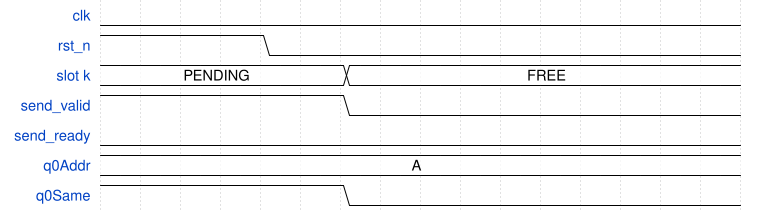
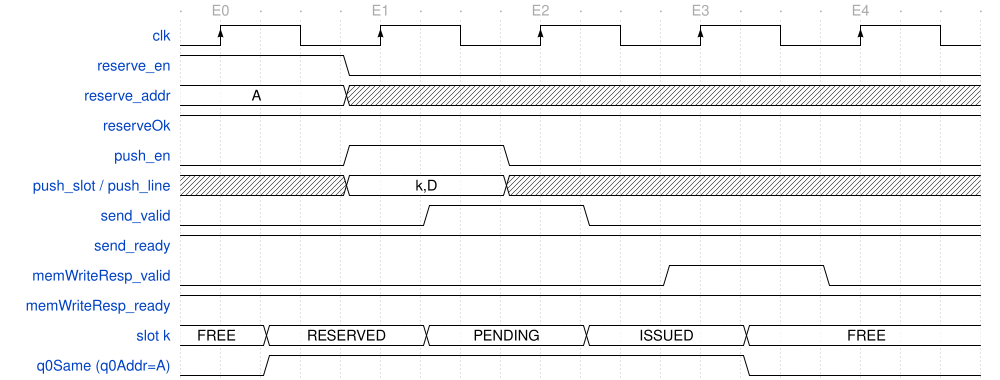
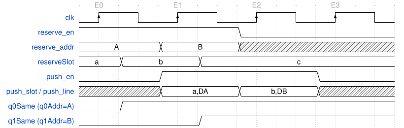
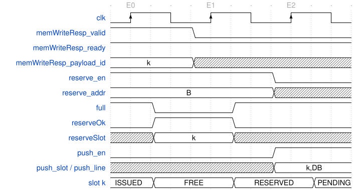
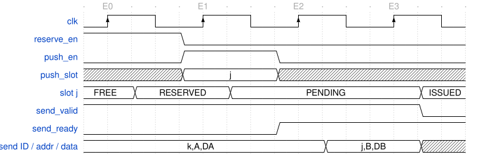
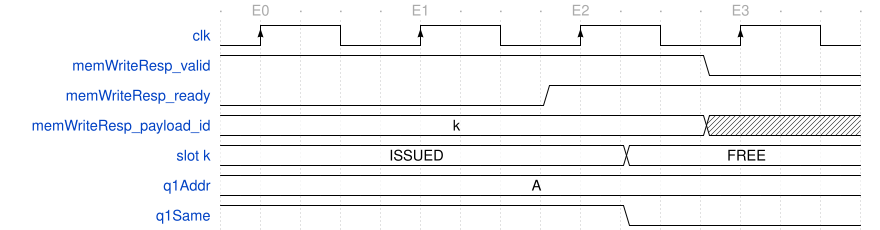
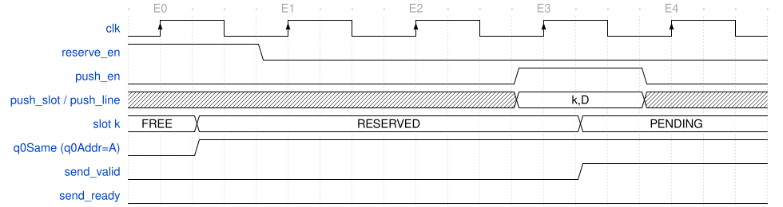

# WriteBackBuffer IP 架构设计文档（v1）

> 版本：v1；状态：接口契约基线，待与 DUT/TB 对齐。
> 依据：《带 MSHR 的非阻塞数据 Cache 架构设计文档 v2》及 WBB 顶层 IO 声明。
> 本文不依据 HDL 内部实现或 C++ 参考模型定义正确行为。
> 用户确认：**异步低电平复位；默认预留成功后的下一拍必须 push，延迟 push 仅作为显式可选模式。**

---

## 目录

0. 文档说明与契约来源
1. 引言与模块边界
2. 总体架构与所有权
3. 参数、地址、数据及 ID
4. 接口定义
5. 时钟、复位与事件记法
6. 槽位生命周期
7. 预留与 push 协议
8. 内存发送与响应协议
9. 地址查询、容量及可见性
10. 并发裁决与 corner 定义
11. 时序图与边沿示例
12. 进展、公平性与异常边界
13. IO 断言及责任划分
14. 集成要求与待对齐事项

---

## 0. 文档说明与契约来源

本 WBB 位于 Cache 淘汰路径和内存写通道之间。本文把 Cache 架构中的写回要求展开为一个可独立驱动、独立检查的 IP 接口契约，使“每个输入何时有效、每个输出依据哪一拍状态、同拍冲突怎样处理”有明确答案。

本文使用三个来源标签，避免将补充定义误写成原架构已经规定的事实：

| 标签 | 含义 | 本文中的主要内容 |
| --- | --- | --- |
| 【继承】 | Cache 架构已有的要求 | 预留计入占用、先预留再push、整行写回、轮询发送、按ID释放、同址顺序、流反压保持 |
| 【用户确认】 | 本次明确的规格选择 | 异步低有效复位；严格下一拍push为默认配置 |
| 【补充定义】 | 原文或IO不足以唯一确定，本文为可执行验证明确的行为 | 沿前状态裁决、无同沿新资源旁路、响应至少晚一拍、轮询超越上界、无效输出字段的检查条件 |

主要出处为 [Cache 架构文档 v2](Cache架构设计文档v2.md) §3、§4、§5.6、§8、§11.4/11.6、§12.3/12.5、§13。端口名称与方向来自 `WriteBackBuffer` 的模块声明；未查看模块声明之后的逻辑。

Cache 架构 §13 目前写“同步复位”，与本次用户确认的 WBB 复位要求不一致。本文采用新确认的要求，原架构和 DUT/TB 的复位修改另行处理。本次 IO SVA 以 `rst_n` 为有效低复位输入，不据现有 HDL 的行为倒推规格。

原架构 §8.3/§12.5 写下一拍push，§8.5 写之后某一拍。本文将它们分成两种显式接口配置，而不是让两种解释混用：默认 `STRICT_NEXT_PUSH=1`；可选 `STRICT_NEXT_PUSH=0`。

## 1. 引言与模块边界

### 1.1 设计目的

脏行被淘汰时，必须先保证整行数据有安全的保存位置，Cache 才能让出原来的存储位置。WBB 在淘汰决策时先承诺一个槽位，在数据返回时接管整行内容，之后独立发起内存写回。这样，Cache 可以继续处理其他行，而不必等待每次写回响应。

### 1.2 范围

WBB 负责槽位预留、整行装载、待发仲裁、内存请求保持、在途跟踪、响应释放以及两路同地址查询。它支持多个在途写事务，并允许内存响应乱序返回。

WBB 不决定 victim，不读取 CacheMem，不清 Cache valid，不分配 MSHR，也不控制 Way Lock。它不知道某行是否脏；**只有脏 victim 才发预留**是上层的责任。清valid与预留的原子性只能在DCache集成层验证，不能仅靠WBB IO证明。

### 1.3 非目标

不支持取消单个预留、重复push更新、部分行写、字节使能、重试错误、异常响应、硬件超时、AXI突发封装或持久化保证。当前接口没有这些能力所需的字段。

## 2. 总体架构与所有权

```text
                 上游淘汰控制 / CacheMem R2
                  │ reserve(addr)   │ push(slot, line)
                  ▼                 ▼
              +--------------------------------+
 q0Addr/q1Addr ──> 槽位资源与地址查询             │
 q0Same/q1Same <── reserved / loaded / issued     │
 full/reserveOk <─                                │
              │ 待发选择 ── 保持已呈现请求 ───────┼──> send(valid, addr, line, id)
              │ 按响应ID释放 <───────────────────┼─── memWriteResp(valid, id)
              +--------------------------------+
                                           内存 / 下游写通道
```

图中的状态和保持功能是抽象职责，不要求使用同名寄存器或某种具体电路。

一次上游逻辑事务包含块地址和整行数据，接口上分成 reserve、push 两个阶段。reserve成功后，上游持有“必须向指定槽push”的义务；push被采样后，数据所有权转交WBB。内存写握手只表示下游接收请求，只有对应写响应握手才结束槽位占用。

## 3. 参数、地址、数据及 ID

| 参数 | 默认值 | 约束与含义 |
| --- | --- | --- |
| ADDR_WIDTH | 32 | 字节地址位宽，至少1位 |
| BLOCK_SIZE | 64 B | 整行字节数，正的2次幂 |
| LINE_WIDTH | 512 | 必须等于8×BLOCK_SIZE |
| WBB_ENTRIES | 4 | 槽数N，正的2次幂；不超过可用写ID空间 |
| SLOT_WIDTH | 2 | 能表示0..N-1；N=1时接口至少保留1位，唯一合法值为0 |
| BUS_ID_WIDTH | 4 | 不小于SLOT_WIDTH；所有有效写ID数值小于N |
| STRICT_NEXT_PUSH | 1 | 验证配置；1为严格下一拍，0为允许后续拍push |

块地址低 `log2(BLOCK_SIZE)` 位为零。`reserve_addr`、`q0Addr`、`q1Addr` 和有效 `send_payload_addr` 都使用块对齐的字节地址。【补充定义】查询端无enable，因此正常工作期间两个查询地址都必须已知且对齐；查询任意未占用块即可表达“当前不关注”，不能用X代替。

每个槽保存完整 `LINE_WIDTH` 位载荷，发送时必须逐位等于对应push的数据。【补充定义】最低字节地址对应行总线 `[7:0]`；默认32位字时，word0对应 `[31:0]`。WBB不改变字节或字的次序。

内存写ID等于预留槽号零扩展到 `BUS_ID_WIDTH`。未收到响应前不能复用这个槽，因而同一个写ID不能对应两笔未完成写。内存读通道属于其他模块；其同数值ID与WBB写ID不冲突。

## 4. 接口定义

方向均以WBB为参照。为描述目标低有效复位，本文使用逻辑名 `rst_n`；当前顶层声明中的引脚仍名为 `reset`，仅凭名称不能判定极性，迁移时需要明确其映射。

| 接口组 | 信号 | 方向 | 有效条件与含义 |
| --- | --- | --- | --- |
| 时钟复位 | clk / rst_n | 输入 | 上升沿采样 / 异步低有效复位 |
| 预留 | reserve_en | 输入 | 本拍尝试预留一个槽；不是不可撤回的Stream valid |
| 预留 | reserve_addr | 输入 | reserve_en=1时有效的victim块地址 |
| 预留 | reserveOk | 输出 | 当前沿前是否存在空槽，与reserve_en无关 |
| 预留 | reserveSlot | 输出 | reserveOk=1时指向一个沿前空槽；成功时上游必须锁存 |
| 数据装载 | push_en | 输入 | 本拍向先前预留槽装载整行，无push_ready |
| 数据装载 | push_slot / push_line | 输入 | push_en=1时有效；槽号和完整行数据 |
| 写请求 | send_valid | 输出 | WBB已经呈现一笔待接受的内存写请求 |
| 写请求 | send_ready | 输入 | 下游本拍可接收写请求 |
| 写请求 | send_payload_addr/wData/id | 输出 | send_valid=1时有效的块地址、整行数据、写ID |
| 写响应 | memWriteResp_valid | 输入 | 下游呈现一笔写完成响应 |
| 写响应 | memWriteResp_ready | 输出 | WBB本拍接受响应 |
| 写响应 | memWriteResp_payload_id | 输入 | valid=1时有效，必须对应已发出但未完成的写 |
| 资源 | full | 输出 | 所有槽均占用，包含仅reserved和已issued槽 |
| 查询0 | q0Addr / q0Same | 输入/输出 | 当前块地址是否在任一占用槽内 |
| 查询1 | q1Addr / q1Same | 输入/输出 | 第二个独立查询口，语义相同 |

【继承/细化】只有send和memWriteResp两组是valid/ready流。reserve是带组合资源反馈的使能接口，push是无反压的使能接口，查询是组合接口。不能把“所有流遵守valid/ready”错误地套用到所有WBB端口。

## 5. 时钟、复位与事件记法

### 5.1 唯一采样沿与沿前状态

记第n个时钟上升沿为 `E[n]`，`Q[n]` 为该沿到达前的逻辑状态。所有接口传输在该沿以稳定的沿前信号判定：

```text
R[n] = reserve_en[n] && reserveOk[n]          成功预留
P[n] = push_en[n]                            整行push
S[n] = send_valid[n] && send_ready[n]          内存请求接受事件
A[n] = memWriteResp_valid[n] && memWriteResp_ready[n]  写响应接受事件
```

后文也使用 `reserve_fire`、`send_fire`、`response_fire` 表示上述握手事件。
所有同拍事件先依据同一沿前状态判合法，再统一形成下一状态。输出是当前状态的组合观察：在沿后的组合传播完成后更新，并在 `E[n+1]` 采样时可见。

### 5.2 异步低有效复位

【用户确认】`rst_n=0` 无需等待clk有效沿即取消全部本地槽位占用。复位后的可见状态为：`full=0`、`reserveOk=1`、`send_valid=0`、`q0Same=q1Same=0`。`reserveSlot`、无效发送payload及响应ready不规定复位数值，不能把未定义字段当作复位失败。

复位期间上游保持reserve_en=0、push_en=0，内存侧保持memWriteResp_valid=0；不承认任何传输。复位释放前，各输入控制和查询地址必须建立为已知值。常规TB在下降沿释放；实际芯片异步复位释放的recovery/removal及同步释放电路属于实现时序检查范围。



[WaveDrom 源文件](figures/wbb/async-reset.json)

图中 clk 始终为低，复位前槽 k 正挂起地址 A 的写请求。rst_n 拉低后，send_valid 和 q0Same 在没有时钟沿的情况下清零。图上的传播间隔仅用于标明先后关系。

WBB的本地复位可以丢弃在途记录，但内存已经接收的写可能仍然完成。接口没有epoch标签，旧ID响应可能被误认为新事务。因此运行中复位必须由系统同时清空/隔离旧响应，并确定丢弃未完成写的语义。当前UVM仅支持启动复位；SVA复位时清除历史和未完成时序义务，不声称单模块能够解决系统热复位。

## 6. 槽位生命周期

每槽使用以下抽象阶段描述，编码和寄存器实现不限：

| 阶段 | 地址已知 | 行数据已装载 | 已向内存发出 | 计入占用/查询 | 允许的下一事件 |
| --- | --- | --- | --- | --- | --- |
| FREE | 不关心 | 不关心 | 否 | 否 | 成功reserve |
| RESERVED | 是 | 否 | 否 | 是 | 对应push |
| PENDING | 是 | 是 | 否 | 是 | send握手 |
| ISSUED | 是 | 是 | 是 | 是 | 对应响应握手 |

```text
FREE --reserve成功--> RESERVED --push--> PENDING --send握手--> ISSUED --响应握手--> FREE
```

阶段不能跳跃。特别地，reserve不代表已有数据，push不代表内存已接收，send握手不代表写回完成。复位可以从任意阶段回到FREE，但必须满足系统取消约定。

## 7. 预留与 push 协议

### 7.1 成功、失败与槽号锁存

`reserveOk` 反映是否有空槽，不能等同于本拍成功事件。只有 `reserve_en && reserveOk` 才分配地址并建立占用。【补充定义】有多个空槽时允许选择任意一个，不要求最低下标；上游必须使用实际返回的 `reserveSlot`。

`reserveOk=0` 时本次尝试无副作用，不建立任何后续push义务。reserve接口没有Stream的保持契约，上游可保持请求等待，也可撤销、稍后重试；保持en时每个成功采样沿都是一笔新的预留，不能误认为一直在重试同一笔。

`reserveSlot` 在成功沿之外可改变，满时不作意义检查。上游不能在下一拍重新读取该输出作为旧事务的push_slot。

### 7.2 地址唯一性

【继承】同一块地址至多占用一个槽，包含RESERVED、PENDING、ISSUED。顶层IO没有“同址拒绝”的独立返回字段，`reserveOk`只表示容量，所以该条件由上游通过查询/调度保证。对已占用地址发出成功reserve属于输入违约，不能要求WBB自动把它当成合并。

若旧写响应与同地址新预留出现在同一采样沿，沿前该地址仍被占用，本版禁止这样的同址复用；下一拍再预留。不同地址、不同槽的事件不受影响。

### 7.3 默认严格下一拍

【用户确认】若 `R[n]=1`，则必须满足：

```text
push_en[n+1] = 1
push_slot[n+1] = reserveSlot[n]
```

push使用的槽必须在沿前处于RESERVED。不能同沿reserve并push新槽，也不能连续多次push同一个已经装载的槽。push没有ready，所以已预留槽的合法push必须被接受；即使WBB已经full或内存send_ready=0，也不能拒绝该push。

### 7.4 显式延迟模式

`STRICT_NEXT_PUSH=0` 时，成功预留允许在任意更晚的采样沿push，但至少晚一拍。在等待期间，槽持续占用、地址查询持续命中，不允许发送尚未push的数据，也没有取消接口。

延迟模式没有硬件规定的最大等待拍数；测试的watchdog或结束排空检查负责发现永久不push。关闭严格下一拍检查不会关闭槽归属、重复push、数据完整性等其他要求。

### 7.5 上游事务完成的含义

一次上游事务在合法push采样后完成交接。driver可在撤销push后调用item_done，不需要等待内存ack。同一逻辑事务的reserve/push保持关联，monitor仍逐拍观察两个阶段。

允许 `push(A)` 与 `reserve(B)` 同拍，但必须是不同槽，且B满足沿前资源约束。当前串行driver不制造这种重叠，不表示IP可以不支持这种并发。

## 8. 内存发送与响应协议

### 8.1 发送资格与数据归属

只有沿前已push且未issued的槽可被呈现为有效send。发送ID必须等于该槽位次，地址等于成功reserve的地址，整行数据等于对应push的数据。

【补充定义】不使用同沿push到send的直通旁路：若push在 `E[n]` 完成，该槽最早可在 `E[n+1]` 发生send握手。该约束不限制另一条早已PENDING的槽与本拍push并行发送。

send_valid为0时，发送payload不作功能比较。接口不承诺从push到首次send_valid的固定延迟；无死锁和轮询进展仍是必须满足的目标。

### 8.2 请求保持与仲裁锁定

【继承】一旦send_valid=1且send_ready=0，下一个采样沿send_valid仍须为1，addr/data/id必须保持。即使新槽刚刚push、资源状态变化或出现更靠前的轮询候选，也不能替换已经呈现的请求。

握手后可在下一拍呈现另一笔请求，也可保持valid连续为1；连续有效且ready为1代表每拍一笔传输。不得在没有握手时置issued，也不得将同槽已经握手的写再次发送。

### 8.3 写响应与释放

响应ID必须对应沿前已完成send握手且尚未响应的槽。允许不同槽响应乱序，也允许每拍返回一笔响应。每笔请求恰好一笔写响应。

【补充定义】响应不能与其首次send握手同拍出现，最早在下一采样沿呈现。若将来要支持零周期响应，必须同时修改此条契约及对应SVA，不能只让TB提前返回。

`memWriteResp_valid && !memWriteResp_ready` 时内存必须保持valid和ID，WBB槽仍占用。只有响应握手才能释放；不把响应valid单独当作完成事件。本版不规定ready必须恒1，也不规定其固定最大反压周期。

从系统语义上，写响应代表该写已完成到足以允许同址后续读取最新值的程度。WBB IO SVA只能检查响应的时序和ID归属，不能证明真实内存已经保存正确数据；后者由memory model和scoreboard检查。

## 9. 地址查询、容量及可见性

### 9.1 沿前资源状态

```text
occupied(slot) = RESERVED 或 PENDING 或 ISSUED
full = 所有槽 occupied
reserveOk = 至少一个槽不 occupied = !full
```

full与reserveOk不得因本拍reserve_en、push_en或响应valid临时改变逻辑含义。push和send只改变生命周期阶段，不改变占用数量；只有reserve成功增加占用、响应握手减少占用。

【补充定义】满状态下，本拍恰好有写响应被接受，也不能组合旁路这个新空位以同时预留；沿后释放、下一拍才可用。如果沿前另有空槽，则允许释放旧槽和预留另一空槽同拍发生。

### 9.2 查询语义

每个qSame独立等于“该查询地址命中任一占用槽”。两查询可同址、异址，分别命中不同槽；查询不改变状态，不必与reserve_addr一致，也没有与reserve/push绑定的硬件要求。

预留的地址在成功沿后立即成为查询对象，并在下一采样沿必须可见；不需要等待push。send握手后仍命中，直到写响应握手后才解除。

在沿前检查中，本沿新reserve不能提前制造查询命中，本沿即将返回的响应也不能提前消除查询命中。SVA检查的是采样点一致性，不能替代组合逻辑传播延迟和毛刺的物理时序验证。

## 10. 并发裁决与 corner 定义

所有合法性以沿前状态为准，不依赖某段实现代码中if语句的先后顺序。

| 同拍/边界场景 | 定义 | 责任与结果 |
| --- | --- | --- |
| 空闲时reserve_en=0、reserveOk=1 | 合法 | 没有发生分配；reserveSlot只指示候选 |
| full时reserve_en=1 | 合法失败尝试 | 不建立占用、不要求下一拍push |
| reserve_en连续高、连续reserveOk=1 | 多笔成功预留 | 每笔都必须履行自己的push义务；上游不能重复同址 |
| 新reserve与同槽push同拍 | 非法 | 上游违约，禁止零拍装载 |
| push(A)+reserve(B)，不同槽 | 合法 | A已预留、B沿前为空；严格模式下一拍仍须push(B) |
| 两槽都有reserved、一个push | 延迟模式合法 | 每拍只有一个push端口；另一个reserved继续占用 |
| push_en连续高 | 每个采样沿一次push | 必须各自对应仍未装载的预留槽；不能重复装载同槽 |
| push到FREE/PENDING/ISSUED | 非法 | 上游违约，不允许无主push或覆盖旧数据 |
| full时push已预留槽 | 合法且必须接受 | full不反压已承诺的数据装载 |
| 同槽push与首次send同拍 | 非法 | 本版没有push直通send |
| push(A)+send(B)，不同槽 | 合法 | B沿前已装载且未issued |
| send stalled期间新增候选 | 合法 | 已呈现的addr/data/id不得改变 |
| send有效而ready=0持续多拍 | 合法 | 无握手，不issued，不释放，不重复事务 |
| 同槽send握手与其响应同拍 | 非法 | 内存违约，响应至少晚一拍 |
| send(A)+response(B)，不同槽 | 合法 | A待发、B沿前issued，各自推进 |
| response.valid=1、ready=0 | 合法等待 | 不释放；响应ID与valid持续保持 |
| 返回未发送、重复、高位非零或越界ID | 非法 | 内存环境违约；不要求DUT提供异常恢复 |
| 满状态response+reserve尝试 | 本拍reserve失败 | 释放槽在下一拍可选，不能同沿复用 |
| 非满时response(A)+reserve(B) | 合法 | B为原先空槽，不得取A的刚释放槽 |
| 旧地址response与同地址新reserve | 非法 | 沿前仍存在同址占用，下一拍再尝试 |
| response(A)+push(B) | 合法 | 不同槽；同槽不可能同时RESERVED和ISSUED |
| reserve、push、send、response四事件同拍 | 条件合法 | 分别使用满足各自沿前阶段的不同槽；小容量可能不可达 |
| 逆序响应，例如先ID3后ID0 | 合法 | 按完整合法ID释放，不按发送顺序释放 |
| reserveSlot在成功之后改变 | 合法 | 上游使用已锁存槽号，不重新读取 |
| 无效周期payload变化 | 合法 | enable/valid为0时对应payload不作功能检查 |
| 查询命中reserved/issued | 必须命中 | 地址占用贯穿完整生命周期 |
| N=1、ID空间宽于槽号 | 合法配置 | 唯一合法槽/发送/响应ID为0，空闲字段无意义 |
| 复位发生在任何阶段 | 本地状态取消 | 必须同时履行系统旧响应隔离约定；当前UVM不测试热复位 |

同址唯一性、非法push和非法响应是模块输入契约；在独立IP环境中由TB负责，在DCache集成层则必须对真正的上游/内存逻辑做断言。不能因为是“环境责任”就在仿真中静默忽略。

## 11. 时序图与边沿示例

E0、E1 等标在 clk 上升沿的正上方，箭头所在的竖线为采样点。时钟高、低电平各占半个周期。沿右侧的状态跳变表示该沿生效后的可见结果，横向间隔仅用于区分采样与更新。图中的槽阶段用于解释所有权，阴影表示该时段忽略相应载荷。

### 11.1 最短完整生命周期



[WaveDrom 源文件](figures/wbb/lifecycle.json)

设 WBB 有多个空槽，E0 预留地址 A 并返回槽 k。E1 采样 push(k,D)，E2 接受整行写请求，E3 接受 ID=k 的写响应。在 E3 上升沿仍能查到 A，沿后查询解除。图中 E2 是最早可发送的沿，仲裁和反压都可延后实际握手。

### 11.2 连续预留与 push 重叠



[WaveDrom 源文件](figures/wbb/overlap.json)

E1 同时发生两件事。B 预留到 b，A 的数据装入 a。此时 push_slot 使用 E0 保存的 a。图中假设还有空槽 c，因此 B 预留成功后 reserveSlot 可以再次变化。两个查询口始终分别查询 A、B。

### 11.3 full 与响应释放



[WaveDrom 源文件](figures/wbb/full-release.json)

E0 到来前所有槽都被占用。虽然该沿接受了槽 k 的写响应，reserveOk 的采样值仍为 0。上游继续请求 B，在 E1 才获得 k，按默认协议于 E2 装入 DB。

### 11.4 请求反压与新候选



[WaveDrom 源文件](figures/wbb/send-stall.json)

槽 k 的请求先挂上写通道。E0 为 B 预留 j，E1 将 DB 装入 j，此时 j 成为待发候选。E2 接收的仍是 k 的原地址 A 和原数据 DA。图中 E2 握手后切换到 j，E3 接收第二笔请求。

### 11.5 响应反压



[WaveDrom 源文件](figures/wbb/response-stall.json)

内存从 E0 开始呈现槽 k 的响应，直到 E2 才握手。其间 memWriteResp_valid 和 ID 必须保持，查询 A 始终命中。E2 沿后 k 释放，E3 采样到 q1Same=0。

### 11.6 延迟 push 模式



[WaveDrom 源文件](figures/wbb/delayed-push.json)

此图采用 STRICT_NEXT_PUSH=0。E0 成功预留后，E1、E2 均未 push，查询 A 仍命中。E3 才装载 D，随后该槽可以呈现有效写请求。把同一轨迹用于默认严格模式时，E1 就会触发 a_env_push_next。

## 12. 进展、公平性与异常边界

### 12.1 轮询公平性

【继承】多个待发槽采用轮询以避免饥饿。【补充定义】本文不规定初始轮询起点或精确候选编码，但要求一个持续PENDING槽在被服务之前，最多被其他槽的成功send握手超越N−1次。SVA按实际握手计数，反压等待拍不计为超越。

被挂起请求保持住原选择时，新候选不能抢占；这是流协议要求，优先于重新计算轮询候选。

### 12.2 无死锁的前提

进展要求以环境最终推进为前提：预留最终获得push、下游最终允许send、每笔发送最终收到响应、WBB最终接收有效响应。在这些条件下，停止新增事务后必须最终排空。

本版不凭空规定“所有写必须在固定K拍内完成”。IO SVA检查安全性和握手超越界，不能仅凭有限采样证明无限时间活性。若WBB永久不产生send且没有其他握手，有界超越断言也不能发现，需要环境watchdog或带公平假设的形式活性检查。

### 12.3 复位与非法输入后的检查

输入非法后DUT行为未定义，但验证必须报告最初的契约违约。SVA的辅助历史在非法所有权转移后停止后续语义比较，避免错误槽索引造成级联误报；独立的X、地址和流保持检查继续工作。下一次复位重新建立历史基线。

该机制不能让失败变成通过：错误计数不因复位清零，回归仍必须检查全部UVM_ERROR/FATAL。覆盖记录也不等于功能已通过。

## 13. IO 断言及责任划分

实现文件：[`wbb_io_assertions.sv`](../verif_mshr/src/wbb/bind/wbb_io_assertions.sv)。
挂接文件：[`bind_wbb.sv`](../verif_mshr/src/wbb/bind/bind_wbb.sv)，只连接 `tb_top` 的接口线，不引用DUT内部状态。

为了表达“先前预留”“已push”“已发送”等历史条件，checker记录由IO事件建立的占用义务、地址、数据和握手计数。这不是另一份替代C++模型的仲裁实现：它不预测具体空槽选择或内部寄存器，只核对DUT声明的选择是否合法以及载荷是否来自已接受输入。

| 断言标签 | 责任 | 检查内容 | 文档章节 |
| --- | --- | --- | --- |
| a_reset_outputs | DUT | 低有效复位后可见空状态，不等待时钟 | §5.2 |
| a_reset_known / a_reset_seen / a_reset_inputs | 环境 | 复位已知、先复位再使用、复位时源端空闲 | §5.2 |
| a_env_controls / a_dut_controls | 各自方向 | 控制信号无X/Z | §4 |
| a_env_reserve_address / a_env_queries | 上游 | 有效预留及常开查询地址已知、块对齐 | §3、§7 |
| a_env_push_payload / a_dut_send_payload / a_env_response_id | 各自方向 | 有效载荷已知、槽或ID范围、地址对齐 | §3、§8 |
| a_dut_send_stable | DUT | send遇反压后valid与全部payload保持 | §8.2 |
| a_env_response_stable | 内存 | 响应遇反压后valid和ID保持 | §8.3 |
| a_dut_capacity / a_dut_reserve_slot | DUT | 沿前full/reserveOk、候选槽确实空闲 | §7.1、§9.1 |
| a_env_unique_address | 上游 | 成功预留不得与现有占用同址 | §7.2 |
| a_env_push_owner | 上游 | push只能装载先前预留且未装载的槽 | §7.3 |
| a_env_push_next | 上游 | 默认严格下一拍push且槽号匹配 | §7.3/7.4 |
| a_dut_send_owner / a_dut_send_content | DUT | 先push再send、无重复发送、地址/数据/ID归属正确 | §8.1 |
| a_env_response_owner | 内存 | 响应只能对应先前已发送槽，禁止同拍零延迟/重复响应 | §8.3 |
| a_dut_query0 / a_dut_query1 | DUT | 两查询覆盖reserved/pending/issued，按沿前状态观察 | §9.2 |
| a_dut_rr_bound | DUT | 持续待发槽被其他成功发送超越不超过N−1次 | §12.1 |

UVM运行时，输入违约报告 `WBB_ENV_*`，输出违约报告 `WBB_DUT_*`，均为UVM_ERROR。
独立checker自测使用 `WBB_SVA_STANDALONE`，通过$error和分类计数验证预期失败，不将负例输出误认为DUT失败。

复位检查在异步下降沿及复位期间的时钟下降沿之后一个仿真精度步（1 ps）观察输出，以避开同一时间槽的NBA更新竞争。这是仿真采样安排，不是给RTL定义1 ps的物理复位延迟，也不替代门级时序检查。

`cover property` 记录reserve→push、reserved/issued查询、full释放、reserve/push重叠、send反压恢复和不同ID的发送/响应同拍。是否真实触发需查看覆盖报告；空闲启动不算这些点已覆盖。

## 14. 集成要求与待对齐事项

1. 默认以严格下一拍模式挂接；定义 `WBB_ALLOW_DELAYED_PUSH` 后，bind将 `STRICT_NEXT_PUSH` 设置为0。必须在编译时显式选择，不用运行时信号悄悄放宽协议。
2. 保持现有DUT/TB复位接线不变。本次SVA直接观察TB的低有效 `rst_n`；当前顶层仍有 `.reset(~rst_n)`。用户后续修改DUT复位极性时，需同时审查TB映射，避免双重取反。本次未验证DUT已经符合新低有效接口。
3. 普通IP仿真将输入契约也作为assert以发现TB错误；形式验证可将相应环境规则改为assume，但不能同时假设DUT输出正确。集成仿真应断言实际上游满足这些规则。
4. 把“脏victim才预留、预留成功后才能清Cache valid、MSHR同址必须等写回”等要求放在DCache集成检查中；WBB没有这些输入，不能编造不可观察的局部SVA。
5. 内存最终写入值由既有C++内存模型和scoreboard验证，IO SVA不能替代存储一致性检查。
6. 本次checker自测仅由人工端口轨迹驱动，不实例化WBB DUT，不读取HDL内部，也不由C++WBB模型生成预期。合法轨迹需零误报，非法轨迹需命中对应责任方错误。
7. 完整UVM编译另受现有 `wbb_sample.rst_n` 被注释而消费方仍引用的接口不一致影响；本次不将修复该项混入IO契约工作。


### 14.1 运行检查器自测

```sh
make -C verif_mshr/sim check_sva
```

该入口仅编译checker、人工IO轨迹和接口桩，不使用 `dut.f`，不编译或运行WBB RTL。
严格模式与延迟模式各27个场景，逐场景验证错误归属，负例还验证指定断言标签确实触发。
另用原挂接文件在接口桩上验证UVM报告路径和bind连接。
2026-11-17在VCS O-2018.09-SP2上三组均通过。
日志位于 `verif_mshr/sim/work/assertions/{strict,delayed,bind}/`。
负例故意产生assertion error；脚本通过场景检查和成功标记判定自测结果，不能要求负例日志零错误。

### 14.2 在完整环境中使用

`tb.f` 已加入checker和bind文件，正常编译默认启用严格下一拍push规则。
需要显式允许延迟push时：

```sh
make -C verif_mshr/sim vcs_compile SVA_DEFINES=+define+WBB_ALLOW_DELAYED_PUSH
```

此开关只调整push期限，不改变DUT、driver或其他所有权/Stream断言。
完整环境运行仍需先解决本节记录的复位字段和DUT/TB复位契约对齐问题。
