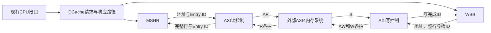

# DCache内存侧AXI4接入方案

版本：方案v1；日期：2026-11-25；状态：待评审，尚未实现。

本文依据[Cache架构设计文档v2](Cache架构设计文档v2.md)、[MSHR IP规格](MSHR_IP架构设计文档.md)、[WBB IP规格](WBB_IP架构设计文档.md)及用户确认事项提出方案。没有阅读DUT的Scala或生成RTL实现，也不以当前实现反推规格。

目标是让DCache通过标准AXI4主接口访问内存。CPU侧继续使用现有请求、读响应和写响应接口。MSHR负责未命中事务，WBB负责脏行写回，AXI控制逻辑负责把它们的整行事务变成总线上的多拍传输。

## 1. 方案依据与范围

原架构规定：Cache为8 KB，32组、4路、64字节一行；CPU每次访问32位整字，采用写回和写分配。MSHR有4个Entry，每个Entry最多4个Slot；WBB有4个槽。内存读写独立，可以有多笔请求未完成，并按各自ID返回。

本方案继承以下义务：

- 一次MSHR Entry生命周期只读取一次内存行，收到完整原始行后才fill，再按Slot顺序replay；最后replay完成才释放Entry和锁。
- WBB从预留开始就阻止同址未命中读，写请求发送之后仍占槽，收到写完成响应后才释放。
- 读写ID相互独立，CPU ID与内存事务ID也不能混用。
- 所有valid/ready输出在反压期间保持；fill_en承担valid语义，不能因新增候选而改变挂起输出。
- 项目采用同一时钟域、异步低有效复位。运行中复位与外部旧响应如何隔离，仍需要系统契约。

上述内容是已有规格要求。64位AXI、具体缓冲结构、AW/W调度和以下资源配置属于**本方案建议**，不表示用户已经确认，也不表示已完成PPA评估。

本版仅产生整行、对齐、普通非独占访问，不增加CPU字节写、AXI原子操作、一致性、MMIO、超时恢复或CPU异常上报。

## 2. 总体连接



DCache对外导出一个标准`Axi4`主接口：AR、AW、W由DCache发出，R和B由DCache接收。读写控制在顶层内部形成清楚的职责边界，可用Area或独立组件组织；不要求购买或引入第三方AXI adapter。

使用Spinal官方`spinal.lib.bus.amba4.axi`中的`Axi4Config`、`Axi4`及其Stream通道。官方库提供信号类型、连接和相关工具，但不会仅凭端口替换就自动处理本项目的行拼接、WBB生命周期和Slot语义。

MSHR和WBB不直接增加AXI拍计数器。这样已有IP级的整行功能验证可以继续使用，新增控制逻辑和顶层连接另行验证。

## 3. 建议的AXI配置

| 项目 | 第一版建议 | 理由 |
| --- | --- | --- |
| 协议 | 完整AXI4，五个独立通道 | 保留读写独立性和burst能力 |
| 地址宽度 | 32位 | 对应原Cache物理地址 |
| 数据宽度 | 64位 | 64字节行拆为8拍；与CPU字宽分开定义 |
| ID宽度 | 4位 | 沿用原busIdWidth，避免这次同时改变ID接口范围 |
| burst | INCR | 一次顺序访问整行，不使用WRAP或FIXED |
| ARLEN/AWLEN | 7 | AXI长度编码为拍数减1 |
| ARSIZE/AWSIZE | 3 | 每拍8字节，编码为log2(8) |
| 读未完成容量 | 最多4行 | 与MSHR Entry数量对应 |
| 写未完成容量 | 最多4行 | 与WBB槽数对应 |
| 同时发送W的数据流 | 一条burst | 不交错不同写事务的数据拍 |
| WSTRB | 每拍8位全1 | 写回完整行，每个字节都有效 |
| RLAST/WLAST | 第8拍有效 | 按实际接受拍数判定，不按经过周期数判定 |

32、64、128位总线分别需16、8、4拍传完一行。本文先固定64位，不要求同时实现并验证所有宽度。若PPA或系统总线另有要求，再调整基线和相应beat数量。

AXI要求一条burst不能跨越4 KB地址边界。当前ARADDR/AWADDR始终64字节对齐，一条burst恰好传输64字节，覆盖地址`base`至`base+63`；64整除4096，因此当前访问方式天然不会跨界。例如最后一条行从`0x0FC0`开始，结束于`0x0FFF`，下一条行从`0x1000`开始。

【用户确认】当前方案不增加运行时的4 KB跨界检测或burst拆分逻辑。生成时确认行大小、地址对齐和burst长度满足上述关系，验证侧用断言及边界地址case检查实际AR/AW符合约定即可。若未来改为任意起始地址、可变长度或一次合并多行传输，需要重新评估，不能直接沿用“不需要检测”的结论。

保留ID、LEN、SIZE、BURST、LAST、STRB和RESP字段。LOCK为普通访问，QOS和REGION若存在则设为0，USER不使用。PROT及ARCACHE/AWCACHE需在接入系统时明确：访问范围应限定为普通RAM，属性必须与平台内存类型和可见性约定一致，不因模块名叫Cache就给属性随意赋值。**属性常量属于实施前待确认项，不能留成X或依赖未核对的库默认值。**

## 4. 字节顺序和ID映射

一行512位，word0位于最低32位，最低地址字节对应line[7:0]。第k个AXI数据拍对应：

```text
beat[k] = line[k*64 +: 64]，k=0..7
地址范围 = base + k*8 至 base + k*8 + 7
beat0包含word0、word1；beat7包含word14、word15
```

读拼接和写拆分使用同一约定，不能一边按高位先发、另一边按低位先收。WSTRB全1表示所有字节都写入，不代表支持CPU部分字写。

建议ARID为Entry号补零到4位；AWID为WBB槽号补零到4位。RID与BID分别查读写记录，数值相同不会形成冲突，不需要为了区分读写额外增加一个ID类型位。对完整ID检查范围，高位非零不能仅截低位后误认成合法位置。

每个读ID同时最多有一条AXI读burst；每个写ID同时最多有一条写回。AXI传输完成记录可先结束，但原Entry/槽是否能重用仍由MSHR/WBB生命周期决定。

## 5. 读控制：发地址、接各拍、交完整行

### 5.1 请求接受

建议第一版不增加读命令FIFO。MSHR的整行读请求直接形成AR候选，仅在对应读记录空闲时允许呈现。

```text
ARVALID = MSHR请求valid且对应读记录可用
MSHR请求ready = ARREADY且对应读记录可用
内部读请求接受 = AR握手
```

MSHR仅在AR真正握手时认为请求已发出。AR受阻时必须保持完整地址及sideband；不能在valid已经呈现后因其他资源变化撤回。对应ID的行缓冲和记录在AR接受时占用，不与写控制共享同一行缓冲资源池。

### 5.2 按ID收集读拍

为4个读ID各保留一份行缓冲、有效状态和已收拍数。AR接受后，RID每次握手把RDATA写入对应ID的下一拍位置，只有RVALID&&RREADY时拍数加1。不同ID可以先后乱序完成，也可以在R通道交错各自的数据拍；同一ID的8拍必须保持原顺序。

该配置的行数据容量是4×64 B=256 B，另加状态和计数。这是逻辑存储量，不是综合面积估计；选择寄存器还是合适的存储结构，需要结合端口和PPA结果决定。

RREADY由是否有合法在途记录、能否保存下一拍等本地资源条件决定，不依赖AWREADY、WREADY或CPU响应ready。接受第8拍时必须看到RLAST；前7拍不得看到RLAST，不能只凭LAST就认定长度正确。

整行收齐后置为待交付。在下一拍或更晚，向MSHR呈现原ID及完整行；反压时保持到整行握手。不能把前7拍或正在变化的拼接缓冲直接作为完整行交给MSHR。

多个完整行同时等待交付时，建议用简单轮询选择，并锁住已经呈现的选择直到MSHR接受。这里是新控制逻辑向MSHR交付整行的调度，**不是要求MSHR的fill增加轮询仲裁器**。

行缓冲直到MSHR整行响应握手后才可回收；MSHR Entry继续保留到最后replay完成。因此读ID不会因为RLAST到达就提前用于另一条未命中。

### 5.3 最快返回边界

内部MSHR不支持首次请求与整行响应同沿接受。将最后AXI读拍注册成完整行、下一拍才交付，可以满足这一要求。

AXI侧不需要强制外部系统满足内部整行接口的延迟。若请求对应的RID尚未在沿前登记，RREADY保持0；若外部已合法呈现R响应，须保持到后续接受。不能将本项目内部的“不支持零拍整行响应”擅自当成对所有AXI从设备的额外限制。

## 6. 写控制：锁住整行，独立完成AW和W

### 6.1 接受WBB事务

建议使用一个64 B活动行缓冲，保存当前写回的地址、数据和ID。只有缓冲可用且该ID没有旧写回未完成时，才向WBB给出ready；握手时将完整事务锁存。

此时WBB的send握手表示“写控制已取得地址与整行数据”，不表示AW或W已经完成。WBB可以置为已发送，但仍保持槽占用和同址查询，直到写完成响应返回。

### 6.2 AW和W独立推进

锁存后，AWVALID和第一拍WVALID可以同时呈现，并各自保持到接受。用awDone和已接受W拍数分别记录进度：

- AW先接受：停止重复AW，继续保持当前W拍。
- W先接受：可以继续后续W拍，AW仍保持；WVALID不能等待AWREADY或AW握手，否则可能与合法从设备的接收依赖形成死锁。
- 只推进实际握手的通道；某拍W受阻时，WDATA、WSTRB、WLAST全部保持。
- 第8拍W携带WLAST；它接受前不得发送下一条burst的数据。

只有AW和最后W均接受后，才允许活动行缓冲装入下一条WBB事务。B不必已经返回；旧ID以小型记录保留在“等待B”状态。因此可以逐条发送W burst，同时有最多4笔写回等待完成。

AXI4的W通道没有WID，数据burst顺序必须与写地址顺序一致，不能交错不同事务的W拍。本方案直到当前AW及全W完成才开始下一条事务，自然满足该顺序。即使W先于本事务AW被接受，也不能开始下一事务，避免地址与数据配错。

### 6.3 B与内部写完成

BID只匹配已完成AW和全W发送的写记录。接受合法成功B后，生成对应的内部写完成响应；建议设置一项完成保持寄存器，内部接收方反压时固定ID，不丢B、不重复通知。

BREADY可在完成保持寄存器有空位且目标记录已具备完成资格时为1。允许保守地等下一拍再接受，不要求同沿释放寄存器后立刻复用。

WBB只有接受这笔内部写完成响应才释放槽。不能在send、AW或WLAST握手时释放。读写控制不能因为两个方向的ID相同而互相删除记录。

## 7. 同址顺序、资源与反压

| 事件 | 表示什么 | 尚未完成什么 |
| --- | --- | --- |
| MSHR请求与AR同时握手 | 总线接受一次读命令 | 未收到完整行，更没有fill或replay |
| 最后一拍R握手 | AXI侧收齐一条行 | 还要将完整行交给MSHR |
| MSHR接受整行 | 可以进入fill阶段 | Entry和锁仍保留到最后replay |
| WBB send握手 | 写控制锁存整行事务 | AW/W可能尚未接受，写回尚未完成 |
| AW与全部W均握手 | 地址及完整写数据已交付 | 仍需等待B |
| 成功B及内部完成交付 | 这笔写回完成通知到WBB | CPU写响应与之没有一一对应关系 |

原WBB同址阻塞从预留开始，到内部写完成接受后才结束。这样新同址读不会绕过尚未完成的写回；无关地址的AR、R、fill和replay可以继续，不需等全部B清空。

AXI的读写通道本身不提供本Cache所需的同址先写后读保证；相同数值的ARID/AWID也不能代替地址检查。平台还须保证在当前内存属性和目标RAM区域中，成功B之后发起的同址读能取得该写回版本；这不是“B代表DRAM物理阵列已更新”的保证。若桥接器可提前确认写入，应核对其可见性与顺序契约。

原NUM_BUS_OUTSTANDING=16的名称不自动表示新增共享信用池。本方案建议分别限制读4笔、写4笔，没有另外的读写总额仲裁；若系统要求更小的总额度，必须另定义分配和无死锁规则。

上游Stage2冻结不能门控已接受的AXI事务。R/B资源应预留或可靠反压，不能等待CPU再发请求才能释放；读控制也不能等待写控制清空才收R，反之亦然。

## 8. 关键采样沿示例

以下沿号只示意顺序，反压可延长任一阶段，不承诺固定总延迟。

| 读路径 | 动作 |
| --- | --- |
| E0 | 内部读请求与AR握手，登记Entry ID |
| E1～E8 | 连续接受8拍R，E8的RLAST=1；也允许其中任意拍停顿 |
| E9或更晚 | 以完整行向MSHR呈现响应，直到它接受 |
| 之后 | MSHR按已有规格fill、replay、最后释放 |

写路径允许下列两种合法顺序：

```text
情况一：锁存整行 → AW接受 → W各拍逐步接受 → B接受 → 通知WBB
情况二：锁存整行 → W先接受若干拍 → AW接受 → 剩余W接受 → B接受 → 通知WBB
```

情况二还允许全部W先完成，再等待AW。两种情况下，直到AW和全W都完成，才能启动下一条写回；B可以晚于下一条写回的发送。

## 9. 错误与复位边界

原spec不提供总线错误向CPU上报、重试或恢复接口。本方案第一版沿用这一范围：**正常功能环境限定RRESP/BRESP为OKAY，SLVERR/DECERR等不作为可恢复业务处理。**不发独占访问，因此不期望EXOKAY。

RESP字段仍保留，验证必须检查，不得把错误数据悄悄当成功行fill，也不得把失败写回当成功完成释放。若实施时要支持错误输入，必须先确定错误状态保持、系统处置及未完成请求取消机制；仅将RESP字段丢弃不足以成为错误处理方案。错误负例的预期是明确报出不支持的响应，不是伪造CPU成功响应。

启动或全系统确认无在途事务时，可清空AXI控制记录和缓冲。已经接受AR或部分AW/W后，不能只复位本地计数就恢复使用旧ID；外部仍可能持有事务或半条burst。AXI通道复位、互连清空、旧R/B隔离必须共同约定。第一版沿用现有热复位待确认项，不将其隐含解决。

## 10. Spinal官方库的使用边界

建议顶层使用`master(Axi4(axiConfig))`，采用完整五通道接口，不将Spinal内部共享地址的`Axi4Shared`作为对外标准端口。读写部分可以使用官方只读/只写视图组织连接；配置字段与API最终以项目采用的Spinal版本核对，本文不提供未经编译的实现代码。

官方Stream寄存或队列工具可用于隔开ready组合路径、保持挂起载荷。但每增加一个缓冲，都必须明确内部握手是在“本地锁存”还是“AXI实际接受”，并记录事务到最终完成的全部状态。不能把一条整行Stream逐字段连接到AXI就认为工作完成。

本方案建议读请求直接对应AR接受、写请求先锁存后发送，这是两个明确且不同的内部接受点。修改接线或加流水寄存时不能悄悄改变这两个含义。

## 11. 验证安排

保持现有WBB/MSHR的IP级验证；另验证AXI读写控制，再跑DCache的CPU到外部内存闭环。这里登记的是DUT行为，不另建立递归的验证环境验收清单。

| 场景 | 必须检查的结果 |
| --- | --- |
| 单条读/写burst | 地址、SIZE、LEN、ID及8拍数据均正确，LAST恰在最后一拍 |
| 各拍独立反压 | AR/AW/W载荷保持；R/B根据资源接收；拍计数只随握手推进 |
| AW先完成、W先完成、交错停顿 | 不等待AWREADY才发W，不重复地址、不丢数据，不提前开始下一写burst |
| 多读ID乱序及交错R拍 | 每个ID独立拼行，字序正确，整行一次性交给原Entry |
| 多笔写等待B、B乱序 | W按地址事务顺序发送，B按ID归属，其他写记录不受影响 |
| 整行交付或写完成被内部反压 | ID和数据保持，缓冲不被下一事务覆盖，通知不丢不重复 |
| 同值读写ID并发 | AR/R与AW/W/B独立，最多4读与4写在途均不串事务 |
| 同址写回后读 | WBB在B通知完成前持续阻止同址读，放行后读到新版本；无关读继续 |
| 完整行数据模式 | 逐字/逐字节、全0/1、单个位遍历，检查64位拍内和拍间位置 |
| 快速响应、相邻完成及资源满 | 不向MSHR形成零拍整行响应；无缓冲溢出、ID过早复用或丢完成 |
| 未定义或错误外部响应 | 明确指出非法ID、长度/LAST错误、重复响应或非OKAY，不当作正确业务完成 |
| 停止新增后排空 | 在所有合法响应最终返回、下游最终接收的前提下，内部与AXI义务全部完成 |

AXI agent负责通道时序和beat拆拼，原C++ SparseMemory仍只保存字节数据。验证不能假定AW与W同拍，也不能只按全局FIFO配对不同ID。CPU架构参考、AXI实际写入的外部MEM、MSHR原始返回行应分清各自更新时刻。

## 12. PPA取舍与实施顺序

第一版新增的主要数据存储为256 B读拼行缓冲和64 B活动写行缓冲，另加读拍计数、写进度、在途ID及完成记录。MSHR和WBB已有的整行存储仍存在，这一开销不能忽略；这里没有声称该结构已达到TSMC28 nm、700 MHz目标。

64位相较128位每行需要更多拍，数据选择及布线宽度较小；128位减少总线占用周期，但可能增加端口和布线代价。评估应分别统计AR到整行交付、写锁存到全W完成、B等待和CPU命中吞吐，不能把内存等待全部算成控制逻辑延迟。单活动写缓冲和保守回收可能引入burst间空拍，可先记录，再决定是否增加第二个缓冲，不提前承诺W通道无空泡。

建议按以下顺序推进：

1. 确认64位基线、属性常量、正常OKAY范围、内存完成可见性及读写并发容量。
2. 将上述接受点、拍序、ID和释放规则写成实施契约，再定义总线控制IO。
3. 完成读侧4 ID拼行及两方向反压，单独验证。
4. 完成写侧独立AW/W调度、顺序发送及多B等待，单独验证。
5. 接入DCache，复跑IP回归与顶层端到端场景；补总线验证点，已有闭合状态不自动覆盖新增AXI路径。
6. 做综合和时序评估，再决定64/128位、缓冲深度和必要流水，不依靠估计宣称PPA达标。

## 13. 外部规范依据

- [Spinal官方AXI4文档](https://spinalhdl.github.io/SpinalDoc-RTD/master/SpinalHDL/Libraries/Bus/amba4/axi4.html)：Axi4Config、五个Stream通道、只读/只写及Shared变体。实际API以采用版本为准。
- [Arm AMBA AXI and ACE Protocol Specification，IHI0022H](https://developer.arm.com/-/media/Arm%20Developer%20Community/PDF/IHI0022H_amba_axi_protocol_spec.pdf)：各通道握手、burst与4 KB限制、W通道无WID及写数据顺序、事务响应和ID规则。
- [Arm Introduction to AMBA AXI4](https://developer.arm.com/-/media/Arm%20Developer%20Community/PDF/Learn%20the%20Architecture/102202_0100_01_Introduction_to_AMBA_AXI.pdf)：五通道及写数据按写地址事务顺序传输的说明。

这些资料规定总线协议；Cache如何分配Entry、何时释放WBB及读Slot应看到哪个版本，仍以本项目架构spec为准。
