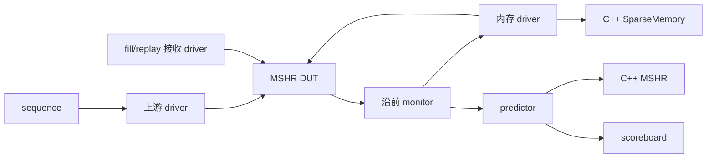

# MSHR UVM 验证框架

MSHR环境位于`src/mshr`，有独立的TB、生成目录和仿真入口。它复用现有C++ MSHR和稀疏内存，用端口采样检查分配、合并、内存读、fill、replay及锁；WBB使用独立的`sim_wbb`入口，两者的生成文件分别位于`generated/mshr`与`generated/wbb`。

目前提供默认空态启动和两笔基础读写smoke，用来检查框架连接。后续21组功能case及配套验证见 [MSHR case规划](../验证计划/DCacheWithMshr/MSHR_case规划_note.md)，不能用基础smoke代替这些场景的闭合。

接口语义、关键采样沿、fill与replay数据视图及corner定义见 [MSHR IP架构文档](../Architecture/MSHR_IP架构设计文档.md)，配有可打开的WaveDrom时序图；未确定的扩展契约在文档中单列。

## 目录和运行入口

```text
verif_mshr/
├── generated/mshr/             # 同次生成的Mshr.v和mshr_params_pkg.sv
├── dpi/mshr_dpi.cpp            # 原有C++模型与稀疏内存的DPI适配
├── dpi/mshr_dpi.h
├── src/mshr/
│   ├── interface/              # 参数化IO及沿前clocking block
│   ├── config/                 # 周期超时、内存延迟/容量、接收开关
│   ├── sequence/               # 公共提交方法和两笔smoke激励
│   │   └── transaction/        # 上游请求、采样快照、比较项
│   ├── component/
│   │   ├── agent/             # 上游agent/sequencer和内存agent
│   │   ├── driver/            # 上游提交、内存响应、fill/replay接收
│   │   ├── monitor/           # 每拍全IO采样
│   │   └── scoreboard/        # 预测比较、IO归属、锁及计数
│   ├── model/                 # C++ MSHR predictor及稀疏内存SV封装
│   ├── bind/                  # 基础IO协议SVA
│   └── pkg/                   # 类包含顺序和DPI声明
├── test/mshr/                 # mshr_base_test、mshr_smoke_test
├── test/adapter/              # MSHR DPI及内存代理独立自检
├── tb/mshr_tb_top.sv
└── sim_mshr/                  # 独立Makefile、filelist、work和脚本
```

以下命令在仓库根目录执行。先生成并编译，之后可切换test或时钟运行：

```sh
make -C verif_mshr/sim_mshr generate
make -C verif_mshr/sim_mshr vcs_compile

# 不指定TEST_NAME：只运行默认空态启动检查
make -C verif_mshr/sim_mshr run

# 一笔读未命中和一笔写未命中的基础通路
make -C verif_mshr/sim_mshr run TEST_NAME=mshr_smoke_test

# 改变时钟周期不改变按拍配置的协议等待
make -C verif_mshr/sim_mshr run TEST_NAME=mshr_smoke_test \
    SIM_ARGS='+CLOCK_PERIOD_NS=4 +ntb_random_seed=1'

make -C verif_mshr/sim_mshr run_verdi
make -C verif_mshr/sim_mshr check_dpi
make -C verif_mshr/sim_mshr check_memory
make -C verif_mshr/sim_mshr check_framework
```

`run`是`vcs_simulate`的别名；`vcs_compile`、`vcs_all`、`run_verdi`、`merge_cov`、`clean`保留原Makefile的使用方式。未指定testname时，TB选择`mshr_base_test`，不会因缺少testname报错。

默认产物在`sim_mshr/work`：`run/simv`、`log`、`wave/wave.fsdb`、`script/dump_wave.tcl`和`simv.vdb`。同名日志及波形可被后一次运行覆盖；需要留证时同时指定独立的`VCS_SIM_LOG`、`WAVEFORM`和`DUMP_TCL`，或直接使用`check_framework`保存各轮产物。MSHR的`vcs_compile`每次重新编译DPI对象，避免C++头文件更新后仍链接旧模型；硬件配置变化时先重新generate并同步C++参数。

## 时钟、复位和参数

[MSHR生成器](../Design/DCacheMSHR/src/main/scala/furina/dcache/MshrVerificationVerilog.scala)显式选择异步低有效复位，生成`resetn`端口；[TB顶层](tb/mshr_tb_top.sv)将`rst_n`直接连到`resetn`，没有高有效取反连接。clk/rst信号只有公共clock driver驱动。

`clk_rst_config`只在TB顶层创建，沿以下路径传递同一个对象：

```text
mshr_tb_top → uvm_test_top → env → clk_agent → clk_agent.driver
```

下层配置缺失或为空会报fatal，不自行创建另一个时钟配置。默认时钟和启动复位拍数来自公共配置；`+CLOCK_PERIOD_NS=4`只改变实际时钟周期。响应延迟、请求等待和总watchdog都按采样拍数计算，monitor的`input #1step`和复位SVA的`#1ps`仅用于采样/结算，不是事务延迟。

默认配置为4 Entry、每Entry 4 Slot、32 set、4 way、64 B行、32位字/地址、5位CPU ID、4位内存ID。生成RTL与[mshr_params_pkg.sv](generated/mshr/mshr_params_pkg.sv)使用同一Scala配置。DPI创建模型时核对所有相关SV/C++参数；C++当前是编译期配置，不能只修改SV包或Scala参数就声称其他配置已经可运行。

## 三类事务对象

| 对象 | 保存什么 | 由谁使用 |
| --- | --- | --- |
| [mshr_transaction](src/mshr/sequence/transaction/mshr_transaction.sv) | 一笔上游Slot提交，或纯查询/空闲操作；包含操作类型、tag/index/way、读写数据、wordOff、CPU ID、WBB附带信息及两路查询输入 | sequence生成，driver消费；提交后反馈实际Entry/Slot |
| [mshr_sample](src/mshr/sequence/transaction/mshr_sample.sv) | 一个上升沿之前的完整四态IO快照，包括复位、输入、输出、握手及lockMask | monitor每拍新建，发布给内存driver和predictor；同一对象供scoreboard比较 |
| [mshr_compare_item](src/mshr/sequence/transaction/mshr_compare_item.sv) | 原样actual_sample句柄和同一拍C++ MSHR预测的查询、发送、fill、replay输出 | predictor产生，scoreboard消费；自身没有模型行为 |

`mshr_transaction.operation`支持`MSHR_ALLOC`、`MSHR_MERGE`、`MSHR_QUERY`和`MSHR_IDLE`。`cycles`只用于查询/空闲持续拍数。`selected_entry`、`selected_slot`初值为-1，driver在实际提交后将结果带回，`entry`保存实际Entry位次；它们是验证环境记录，不是增加的DUT端口。

CPU ID按照沿前在途集合检查：某笔replay握手完成之后，下一次提交才能复用其ID；当前profile不允许同一沿既完成旧ID又提交同ID新请求。DPI与IO历史检查采用同一规则。

两路查询使用`q0Tag/q0Index/q1Tag/q1Index`。数据和请求字段由sequence提供，driver不生成随机激励。`mshr_base_sequence::step()`等待本项提交完成，`query()`和`idle_cycles()`用于独立观察或等待，不等待整个Entry的内存/fill/replay流程。

## 上游driver的时序

alloc/merge是使能接口，没有ready。满时不能像Stream那样持续拉高en等待；[driver](src/mshr/component/driver/mshr_driver.sv)先确认资源，再单拍提交。

| 阶段 | driver行为 |
| --- | --- |
| 准备查询 | 下降沿将alloc/merge使能置0，q1临时查询本请求的tag/index；q0使用transaction给出的查询。 |
| 等待资格 | 至少保持一整个周期后，在下降沿读取已经更新的实时查询结果。ALLOC需要hasFree、目标块未命中且目标set/way未锁；MERGE需要目标命中、mergeable且slotFree。等待期间en始终0。 |
| 单拍提交 | 在最终资格判断的同一下降沿送出payload和一个en，同时将q0/q1恢复为transaction指定的独立查询。下一上升沿接受该Slot。 |
| 采样和完成 | 用mon_cb确认提交及Entry身份，下一下降沿撤销en后item_done。内存响应、fill和replay继续独立运行。 |

最终资格判断没有使用上一上升沿留下的旧查询，因为该沿可能已经接受响应并使Entry进入FILL。准备阶段保持q1稳定，下一下降沿才读取，不需要硬编码ns延迟。MERGE目标不存在或已进入不可合并阶段时明确报错，不自动改成alloc；Slot满时只等待，不重复提交。

本框架的driver没有实现每拍连续提交调度器，也没有允许alloc与merge同拍；这些与一个Slot是否已完成replay是不同问题。基本提交返回后即可开始下一请求，不强制串行等待内存完成。

## C++模型、内存代理和检查链



[predictor](src/mshr/model/mshr_predictor.sv)通过`mshr_ref_*` DPI访问已有[RefModel/Cache/MSHR.hpp](../RefModel/Cache/MSHR.hpp)。函数声明在[pkg/mshr_dpi.svh](src/mshr/pkg/mshr_dpi.svh)，适配实现位于[dpi/mshr_dpi.cpp](dpi/mshr_dpi.cpp)。`mshr_ref_step()`统一设置输入、读取沿前输出并调用一次`tick()`；`sendReq()`和`fillReq()`有呈现副作用，由该入口统一调用。

[mshr_memory_store](src/mshr/model/mshr_memory_store.sv)通过`mshr_mem_*` DPI封装已有[RefModel/MEM/SparseMemory.hpp](../RefModel/MEM/SparseMemory.hpp)。`write_line()`预置外部内存，`read_line()`读取整行，二者都不访问DUT内部。内存driver在实际读请求握手时读取一次并保存数据快照，此后等待响应期间不重新读内存。

[memory driver](src/mshr/component/driver/mshr_memory_driver.sv)负责请求ready、FIFO待响应队列、周期延迟和响应握手。第k拍接受请求，延迟L拍且无队列/接收阻塞时，在第k+L拍响应。已呈现的响应对象锁定到握手，即使`mem_response_enable`后来关闭也不会撤回。当前支持FIFO响应；乱序及随机时序留给后续case扩展。

[sink driver](src/mshr/component/driver/mshr_sink_driver.sv)独立驱动fillReady和replay.ready。它只控制接受，不改fill/replay数据。[scoreboard](src/mshr/component/scoreboard/mshr_scoreboard.sv)逐拍比较C++预测，并使用实际alloc、读发送/响应、fill和replay事件记录Entry/Slot归属、CPU ID及全lockMask；这份IO历史用于协议检查，不是第二个完整MSHR参考模型。

无取消场景收尾要求：

```text
alloc = readReq = readResp = fill接受 = Entry释放
alloc + merge = replay接受
```

`env.is_idle()`同时要求C++ MSHR为空、内存待响应/在途ID为空、scoreboard中的实际Entry/CPU ID为空。fill是向Cache写合并行的接口，不能直接写回后端MEM。每笔读Slot的期望来自原始响应行和此前同字写，不能把最终fill行当作所有读的期望。

## 当前test和自检

| 入口 | 功能 |
| --- | --- |
| `mshr_base_test` | 默认启动时钟、异步低有效复位，运行空态检查；不发alloc/merge。 |
| `mshr_smoke_test` | sequence准备两行逐字不同数据；第一笔读首字，第二笔写另一行末字。检查两笔读请求/响应/fill/replay/释放，纯读clean、含写dirty、原始数据和CPU ID，并确认fill未修改外部MEM。 |
| `check_dpi` | 独立检查SV/C++ ABI、参数、模型生命周期及稀疏内存调用，不等价于DUT功能case。 |
| `check_memory` | 使用真实monitor、内存driver和C++内存检查周期响应、响应保持及请求时快照；不实例化MSHR DUT。 |

基础SVA位于[bind/mshr_io_assertions.sv](src/mshr/bind/mshr_io_assertions.sv)，检查复位、使能互斥、有效字段/索引、读请求和响应保持、fill有效载荷及replay保持。复杂生命周期由scoreboard的IO记录补充。cover的match只表示对应事件出现，不等于相关验证点已全部闭合。

仿真结果须同时核对UVM_ERROR/FATAL、`MSHR_TEST_PASS`和`MSHR_COUNTS`；smoke另有`MSHR_SMOKE_COVERAGE`。`check_framework`自动编译，运行无testname启动和smoke的10 ns/4 ns组合，保存输入哈希、独立日志/波形、JSON和Markdown报告，并在终端打印带颜色的PASS/FAIL表。非终端默认不加颜色，可用`python3 -B verif_mshr/sim_mshr/script/run_mshr_framework.py --color always`显式开启。

## 本轮验证记录

2026-11-20的[框架汇总](sim_mshr/work/framework/run_20261120_103457_803704/summary.md)为**4/4 PASS**，各组UVM_WARNING/ERROR/FATAL均为0。默认空态没有事务；smoke各完成2次alloc、内存读请求/响应、fill、replay及Entry释放，其中读/写replay各1次，merge=0。两种时钟使用相同周期数，复位为ASYNC_LOW。

- [框架JSON与执行命令](sim_mshr/work/framework/run_20261120_103457_803704/summary.json) / [输入源码哈希](sim_mshr/work/framework/run_20261120_103457_803704/inputs.json)。
- [DPI自检日志](sim_mshr/work/dpi/run.log)：`MSHR_DPI_ADAPTER_PASS`，覆盖packed行、实例隔离、R-W-R历史读视图、非法ID/重复响应及生命周期；这是适配器自检，不是DUT合并case。
- [内存代理自检报告](sim_mshr/work/memory_timing/summary.json)：10 ns/4 ns × 1/2/32拍共6组正常运行通过，每组5请求/响应、3次精确延迟、5次快照检查；另1组0拍配置按预期报fatal。合计7/7自检通过，负例不计入正常DUT功能PASS。

本轮只证明框架和上述基础通路；merge、候选插入、乱序等DUT场景仍按规划逐项补齐。运行产物位于可清理的work目录，清理前需保留相应证据。

## 扩展入口和当前边界

后续test继承`mshr_base_test`，复用周期watchdog、排空和计数检查。各自的地址/数据随机化、请求排列和场景调度放进sequence，`mshr_config`负责控制参数。MEM响应策略可在内存driver中扩展，fill/replay接收策略可在sink driver中扩展，扩展后仍保留实际握手采样与独立协议检查。

目前尚未展开规划中的容量、合并、数据历史、候选插入、仲裁、乱序、复用和随机case。alloc/merge仍按现有C++模型的互斥契约运行；在途Entry复位取消与旧响应隔离尚未定义。空态再次复位不清外部内存，但还需要独立case验证完整复位过程。

fill.en&&fillReady才计一次接受；Q-02未确认前，没有把fill反压期间选择/payload保持强加为Stream断言。MSHR读请求和replay已经是Stream，仍必须遵守背压保持。`hasWb/wbSlot`在当前MSHR IO中没有对应可观察输出，不能用C++字段保存代替DUT内部保存证据。跨参数回归也尚未由默认四Entry框架运行结果证明。
